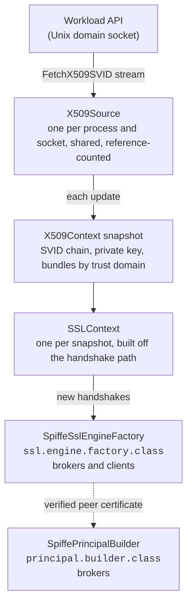

# kafka-spiffe: design

Status: approved. Phase 0 (the spike, [docs/spike/phase-0.md](spike/phase-0.md)) and phase 2 are done; the rest is answered as the work reaches it.

## 1. Scope

kafka-spiffe is a Java library that gives Apache Kafka brokers and clients, 3.0 and later, mutual TLS based on [SPIFFE](https://spiffe.io/), without files:

- **It talks to the SPIFFE Workload API directly**, over its Unix domain socket, and keeps the workload's X.509-SVID, its private key and the trust bundles (federated ones included) in memory. The Workload API streams rotations, and they take effect without restarting the broker or the client, and without closing the connections that are open.
- **It verifies peers by SPIFFE ID**, never by host name: a client says which broker identities it accepts, a broker which client identities and trust domains.
- **It makes the peer's SPIFFE ID the Kafka principal**, so ACLs (`StandardAuthorizer`) are written against `Spiffe:spiffe://trust-domain/path`.

Out of scope: JWT-SVIDs, SASL, authorization itself (Kafka's authorizer does it, on the principal this library produces), and SPIRE's deployment.

### Why

A typical setup: a Kafka broker in one trust domain (`example.org`, with an SVID of an hour), whose SPIRE server federates with that of a Kubernetes cluster (`k8s.example.org`), where client pods get SVIDs of a few minutes. Without this library, the broker and each client run spiffe-helper, which writes PEM files, and the broker reloads its keystore. That costs a sidecar per workload and private keys on disk; Java clients never reload a keystore at all, so a client outlives its certificate unless it restarts; and the broker's principal is the SVID's subject DN, which says nothing about the workload.

## 2. Architecture



### The Kafka extension points

Three ways to get rotating SPIFFE material into Kafka's TLS were weighed:

| | New SVID on new handshakes | Per-instance policy | Where |
|---|---|---|---|
| **A. `ssl.engine.factory.class`** (chosen) | Yes: each engine comes from the current snapshot's `SSLContext` | Yes: from the config map the factory is given | Brokers, clients, Connect, Streams, CLI tools (`--command-config`) |
| B. A JCA provider with live key and trust managers (`ssl.keymanager.algorithm`, `ssl.trustmanager.algorithm`, `security.providers`) | Yes: the key manager reads the current SVID at each handshake | No: `KeyManagerFactory.init` receives no Kafka configuration, so policy is JVM-wide | Brokers, clients |
| C. PEM files and dynamic broker reconfiguration (today) | Only after the file is rewritten and a reload is triggered | n/a | Brokers only; Java clients do not reload |

**A** is the main path. **B** may ship later as an optional extra over the same core, for places where `ssl.engine.factory.class` cannot be set; its policy would come from a properties file named by a system property.

What A relies on, read from `kafka-clients` 4.3.1 and checked against 3.0.0 and 3.9.1, where all of it is the same unless said otherwise:

- `SslEngineFactory` (extends `Configurable`, `Closeable`): `createClientSslEngine(peerHost, peerPort, endpointIdentification)`, `createServerSslEngine(peerHost, peerPort)`, `shouldBeRebuilt(Map)`, `reconfigurableConfigs()`, `keystore()`, `truststore()`.
- Kafka creates one `SSLEngine` per connection, so a factory that hands out engines from the newest `SSLContext` rotates on every new handshake with no rebuild.
- `SslFactory.reconfigure()` builds a new factory only when `shouldBeRebuilt` says so; its checks for DN and SAN changes (`ssl.allow.dn.changes`, `ssl.allow.san.changes`) and its validating handshake run only when `keystore()` is not null. This factory returns null from `keystore()` and `truststore()`: those checks mean nothing for SVIDs, whose DN changes and whose SAN does not.
- On the inter-broker listener `SslFactory.configure()` validates the factory by a handshake with itself, with an empty peer host. So a broker's client side must accept its own server SVID, and the broker's own ID or trust domain must be allowed (§4).
- The factory is never told which listener it is for: unknown keys such as `spiffe.*` reach it, but a listener-prefixed unknown key (`listener.name.x.spiffe.foo`) arrives still prefixed, and is dropped altogether on its own listener when the same key is also set without the prefix (phase 0, Q4). Handshake policy is therefore per process; the principal builder, which is told the listener, refines it per listener with keys that carry the listener name inside the `spiffe.` namespace (§4, §5).
- A broker creates one factory per network thread per listener (`num.network.threads`) and one per inter-broker client (replica fetchers, the controller channel, transaction markers): ten on a 4.4 broker with two TLS listeners. They share one source through the registry.
- Kafka does not close every factory it makes: `SslFactory.validateReconfiguration` configures one and drops it, and so does `configure` when the validation handshake fails (3.0 to 4.4). So a factory registers no listener on the shared source, which would keep it reachable, and builds a rotated snapshot on the next engine it makes; its handle on the source is released by `close()` or, for a factory dropped unclosed, when it is collected (`java.lang.ref.Cleaner`).
- The principal builder is created and configured **per connection** (`SslChannelBuilder`'s authenticator is), and `build` is called **for every request**, on the network thread. Its `configure` must be cheap and its principal is computed once per connection.
- **`spiffe.*` keys are static, by the library's own policy**, not because Kafka withholds them. `kafka-configs --alter` accepts them (stored as sensitive, values hidden), and Kafka can still hand one to the library: when a standard SSL key of a listener changes, the new configuration it passes to `SslFactory.reconfigure` includes every non-Kafka key, and `SslFactory` copies into the next factory's configuration those its `reconfigurableConfigs()` lists (`DynamicBrokerConfig.processReconfigurable`, `SslFactory.createNewSslEngineFactory` at 4.4.0); and a 3.x ZooKeeper broker loads its stored dynamic configuration before it creates its listeners (`KafkaServer.scala:268` before `:383` at 3.9.1, `KafkaConfig.originals` delegating to the current configuration), so a stored value reaches `configure()` at the next restart. The policy: `reconfigurableConfigs()` lists no `spiffe.*` key, so a rebuilt factory keeps its predecessor's `spiffe.*` values; and the operator documentation says never to set `spiffe.*` dynamically, since on a ZooKeeper broker a stored value takes effect at the next restart and `configure()` cannot tell it from a static one (phase 0, Q3).
- The factory and the principal builder are created with `Utils.newInstance`, not as `Plugin<>`, so KIP-877 plugin metrics do not reach them. Metrics are JMX MBeans of their own (§7).
- `KafkaPrincipalBuilder` extends `KafkaPrincipalSerde` from 4.2 on. Up to 4.1 it does not, and the channel builders hand the serde on only `if (principalBuilder instanceof KafkaPrincipalSerde)`, so the builder declares both interfaces (§5). Phase 0 ran it: on a 3.3 or 3.9 KRaft cluster a builder without the serde fails every forwarded request (`Cannot deserialize principal from request context`).
- An exception from `createServerSslEngine` or `createClientSslEngine` fails only that connection: the broker's processor closes it and goes on, the client's `NetworkClient` retries on its backoff (phase 0, Q2). An exception from `build` closes the connection after the handshake, with no error the client can see (Q1).
- `kafka-clients` (Java 8 bytecode in 3.x, 11 in 4.x) shades its own protobuf, and the library has no dependencies of its own (§3), so nothing on a broker's or client's class path can clash with it.

### Kafka versions

The floor is Kafka 3.0, for brokers and clients, because Kafka 3.x is still widely run. Everything the library uses has the same shape from 3.0 to 4.3: `ssl.engine.factory.class` (since 2.6), `SslEngineFactory` with the same six methods, `SslFactory` skipping its keystore checks and validating handshake when `keystore()` and `truststore()` are null, `KafkaPrincipalSerde` (since 2.8), and the three authentication contexts. The differences that matter:

| | 3.x | 4.x |
|---|---|---|
| Principal serde | Used only when the builder is an `instanceof KafkaPrincipalSerde` | The same in 4.0 and 4.1; part of `KafkaPrincipalBuilder` from 4.2 |
| Authorizer | `AclAuthorizer` on ZooKeeper clusters, `StandardAuthorizer` on KRaft | `StandardAuthorizer` |
| Requests forwarded to a controller | KRaft clusters only | Always |
| JDKs (Kafka's documentation) | Clients 8 and later, brokers 11 and later (8 deprecated) | Clients 11 and later, brokers 17 and later |
| JDKs this library runs on (phase 0) | 17, 21 and 25, brokers and clients, from 3.0.2; SASL listeners of 3.0 to 3.3 call `Subject.getSubject`, which fails from JDK 23 on, but no TLS path does | 17, 21 and 25 |

The library is compiled against `kafka-clients` 3.0.0, so a call into an API added later fails to compile, and tested against 3.x and 4.x (§9). Java 17 bytecode means a 3.x client or broker is served only on Java 17 or later.

### Rotation

- `X509Source` keeps one `FetchX509SVID` stream open. Each update that passes validation becomes an immutable `X509Context`, and an `SSLContext` is built for it on the update thread.
- `createServerSslEngine` and `createClientSslEngine` take the current context. New handshakes use the newest SVID and bundles; open connections keep the session they negotiated and are not touched.
- One `SSLContext` per snapshot: no handshake mixes the key of one snapshot with the trust of another.
- **Sessions are not resumed.** A session timeout counts from each session's creation, so no timeout can keep a session made late in an SVID's life from being resumed after that SVID, or the peer's, has expired, and a resumption checks neither certificate; a TLS 1.3 server's stateless tickets are in no cache that could be swept. Both session contexts therefore time sessions out after one second, the shortest the JDK allows (zero means no limit). Kafka's connections are long-lived, so a full handshake on reconnecting costs little.
- `shouldBeRebuilt` is true only when `ssl.enabled.protocols`, `ssl.cipher.suites` or `ssl.client.auth` changed, the keys `reconfigurableConfigs()` lists. A rebuilt factory takes the same shared source and its predecessor's `spiffe.*` values, so a rebuild is cheap. Kafka calls it on every dynamic broker update, whatever changed.

## 3. Components

One Bazel package per Java package, under `io.github.bpalermo.kafka.spiffe`:

| Package | Contents | Depends on |
|---|---|---|
| `id` | `SpiffeId`, a strict parser of the SPIFFE ID specification (lowercase trust domain of `[a-z0-9._-]`, path segments of `[A-Za-z0-9._-]`, no empty, `.` or `..` segment, no trailing slash, port, user info, query, fragment or percent-encoding); `TrustDomain`; `SpiffeIdMatcher` (exact IDs, trust domains, path globs where `*` is one whole segment and `**`, last only, one or more trailing segments) | JDK |
| `x509` | `X509Svid`, `X509Bundle`, `BundleSet`, `X509Context` (the snapshot), `SvidLeaf` (the X.509-SVID leaf checks), `SvidValidator` (key matches leaf, validity, leaf constraints, own bundle present, no empty bundle), `SpiffeTrustManager` (per-trust-domain PKIX and the matcher; refusals carry a reason, `PeerRejectedException`), `SnapshotSslContext` | JDK |
| `workload` | `WireReader` (the subset of the protobuf wire format the Workload API needs), `WorkloadApiClient` (`FetchX509SVID` with the `workload.spiffe.io: true` header), `X509Source` (the stream, reconnects with backoff and jitter, rejects a bad update and keeps the current snapshot, listeners, an injectable clock), `X509SourceRegistry` (one source per socket per process, reference-counted), `X509MaterialSource` (the interface another source of material, such as files, can implement) | JDK |
| `workload.h2` | The client side of HTTP/2 and gRPC that one streaming call needs: `Http2Connection` (frames, settings, flow control, ping, goaway), `Hpack` (encoder and decoder, Huffman), `GrpcStream` (message framing, status from trailers) | JDK |
| `kafka` | `SpiffeSslEngineFactory`, `SpiffePrincipalBuilder`, `SpiffeConfig` (a `ConfigDef`), `PrincipalMapper` | `kafka-clients` (provided) |
| `kafka.jca` | Optional, later: `SpiffeSecurityProviderCreator` and key and trust manager factories over the same source | `kafka-clients` |
| `metrics` | JMX MBeans, which can be turned off | JDK |

### The Workload API client

The client is our own, not `java-spiffe` and not grpc-java:

- The Workload API needs one streaming call and a handful of fields: `X509SVIDResponse` {`svids` = 1, `crl` = 2 (ignored), `federated_bundles` = 3} and `X509SVID` {`spiffe_id` = 1, `x509_svid` = 2, `x509_svid_key` = 3, `bundle` = 4, `hint` = 5}. A ~60-line reader of the protobuf wire format covers them, with no generated code and no protobuf-java.
- `java-spiffe` brings grpc-protobuf, protobuf-java and nimbus-jose-jwt (for JWT-SVIDs, which are out of scope), and its provider's policy is JVM-wide. It is not used, not even as a test oracle: the SPIFFE ID parser is tested against the specification's rules (phase 2).
- **No gRPC, no Netty.** grpc-java reaches a Unix domain socket only through Netty's native epoll or kqueue transport. Netty clashes with the Netty 4.1 every 3.x broker carries in `libs/`, so it would have to be relocated in a shaded jar (phase 0 did it: 9.9 MB, with string constants, service files and the native library to rewrite), and its native library ties the jar to the platforms it ships for. The JDK has had Unix domain sockets since Java 16 (`SocketChannel.open(StandardProtocolFamily.UNIX)`), with no native code of ours, so the library speaks the little HTTP/2 and gRPC the call needs itself, and has no dependencies at all.

What `workload.h2` implements, and no more:

- **Connection.** A blocking `SocketChannel` to the agent's socket; HTTP/2 with prior knowledge (the client preface, no upgrade, no TLS); one stream per connection. One daemon thread per socket reads frames; writes are serialised under a lock.
- **Frames.** `SETTINGS` (sent: `ENABLE_PUSH=0`, a 1 MiB `INITIAL_WINDOW_SIZE`; received ones acknowledged and honoured), `HEADERS` with `CONTINUATION`, `DATA` (padding stripped), `WINDOW_UPDATE` for the connection and the stream as received data is consumed, `PING` answered, `PRIORITY` and unknown frame types ignored.
- **Errors we detect** are sent with the code and scope RFC 9113 requires: a frame larger than our `MAX_FRAME_SIZE`, or a frame of the wrong length for its type, is `FRAME_SIZE_ERROR`; a header block HPACK cannot decode is a connection error `COMPRESSION_ERROR`, since the decoder's state is then lost; received data beyond a window is `FLOW_CONTROL_ERROR`; other violations are `PROTOCOL_ERROR`. A connection error sends `GOAWAY` with the code and closes; the stream then ends as `INTERNAL`.
- **Errors the agent sends** are translated as gRPC's HTTP/2 mapping says, never by reading the HTTP/2 code as a gRPC status number: a received `RST_STREAM` with `REFUSED_STREAM` is `UNAVAILABLE`, `CANCEL` is `CANCELLED`, `ENHANCE_YOUR_CALM` is `RESOURCE_EXHAUSTED`, `INADEQUATE_SECURITY` is `PERMISSION_DENIED`, and every other code (`NO_ERROR` before the trailers included) is `INTERNAL`. A `GOAWAY` whose last stream ID is below ours, or a connection that closes before the trailers, ends the stream as `UNAVAILABLE`; one that covers our stream lets it finish.
- **Headers.** HPACK (RFC 7541): requests are encoded as literals without indexing and without Huffman, which every decoder accepts; responses are decoded in full, with the static and dynamic tables, table size updates and Huffman decoding. Limits: a header list of at most 64 KiB, a dynamic table of the default 4 KiB.
- **gRPC.** `POST /SpiffeWorkloadAPI/FetchX509SVID`, `content-type: application/grpc`, `te: trailers`, `grpc-accept-encoding: identity` and the `workload.spiffe.io: true` header; the request is one empty, length-prefixed message and `END_STREAM`. Response messages are length-prefixed (a compressed flag is refused, since none was offered) and may span `DATA` frames; a message over 16 MiB is refused. The status comes from `grpc-status` (and `grpc-message`, percent-decoded) in the trailers or a trailers-only response, and an explicit `grpc-status` always wins, whatever the HTTP status. Only when it is missing does the HTTP status decide, by gRPC's table: 400 is `INTERNAL`, 401 `UNAUTHENTICATED`, 403 `PERMISSION_DENIED`, 404 `UNIMPLEMENTED`, 429, 502, 503 and 504 `UNAVAILABLE`, any other `UNKNOWN`, and a 200 without `grpc-status` is `UNKNOWN` too.
- **What the source sees.** A stream of responses, then a status: `UNAVAILABLE` (connection lost, `GOAWAY`, refused stream), `PERMISSION_DENIED`, `INVALID_ARGUMENT`, `INTERNAL` and the rest, which §6 handles: `INVALID_ARGUMENT` is not retried, everything else is retried with backoff.

About 1,000 to 1,500 lines, most of them HPACK and frame handling. HTTP/2 is where subtle bugs live, so it is tested against the RFC's own vectors, against grpc-java as a server and against a real SPIRE agent (§9).

## 4. Configuration

Every key starts with `spiffe.`. They are read from the map Kafka passes to `configure()`, validated by a `ConfigDef`, and an unknown `spiffe.*` key is an error, so a typo does not go unnoticed. A `listener.name.<listener>.spiffe.*` key that reaches `configure()` is an error too. That catches it only when Kafka passes it on: when the same key is also set without the prefix, Kafka may drop the prefixed one before the library sees it (`ChannelBuilders.channelBuilderConfigs`), and nothing the library is given shows it was there. The operator documentation therefore says plainly that the form does not exist, and per-listener keys have a spelling of their own (`spiffe.principal.listener.<listener>.*`) that no filter touches. The keys are static (§2): set them in the properties file, never through `kafka-configs --alter`.

### Source

| Key | Meaning | Default |
|---|---|---|
| `spiffe.endpoint.socket` | `unix:///path` (or `unix:/path`) of the Workload API, an absolute path. Nothing but `unix:` is accepted | `$SPIFFE_ENDPOINT_SOCKET` |
| `spiffe.svid.hint` | Pick the SVID with this Workload API hint | the first SVID |
| `spiffe.svid.id` | Pick the SVID with this SPIFFE ID | the first SVID |
| `spiffe.startup.timeout.ms` | How long `configure()` waits for the first SVID; `-1` waits for ever, `0` only accepts a source that is already warm | 120000 |
| `spiffe.reconnect.backoff.ms`, `spiffe.reconnect.backoff.max.ms` | Reconnect backoff, with jitter | 500, 30000 |
| `spiffe.bundle.trust.domains` | The bundles to trust, among those the agent delivers. SPIRE already federates per registration entry; this is defence in depth | all |
| `spiffe.svid.expired` | What engines do once the SVID has expired and no rotation came: `present` (keep presenting it) or `fail` (refuse to create engines) (§6) | `present` |

### Peer verification

| Key | Meaning |
|---|---|
| `spiffe.peer.allowed.ids` | Exact SPIFFE IDs |
| `spiffe.peer.allowed.trust.domains` | Any ID of these trust domains |
| `spiffe.peer.allowed.id.patterns` | Path globs, such as `spiffe://k8s.example.org/ns/*/sa/**`: `*` is one whole segment, `**` (last only) one or more trailing segments, and the trust domain is exact. `web-*` is refused, not matched literally |

At least one of the three is required, on clients and on brokers: there is no implicit "anything a bundle vouches for". A broker also requires `ssl.client.auth=required`, unless `spiffe.server.allow.unauthenticated=true`; only a broker's configuration has `ssl.client.auth`, so a client's factory is not affected, and a server engine of a factory without it requires a client certificate. `spiffe.principal.listener.<listener>.*` keys are accepted by their shape (`allowed.ids`, `allowed.trust.domains`, `allowed.id.patterns`); any other `spiffe.*` key not in the tables is an error.

### TLS

- `ssl.protocol`, `ssl.enabled.protocols`, `ssl.cipher.suites`, `ssl.provider` and `ssl.client.auth` are honoured.
- `ssl.endpoint.identification.algorithm` is ignored: host names are never verified (logged once). `ssl.keystore.*` and `ssl.truststore.*` are ignored, with a warning, since setting them suggests a mistake.

### Principal builder

| Key | Meaning | Default |
|---|---|---|
| `spiffe.principal.type` | The principal type: `Spiffe`, or `User` for authorizers and tools that know no other (§5) | `Spiffe` |
| `spiffe.principal.mapping.rules` | `RULE:<regex>/<replacement>/[L\|U], ..., DEFAULT`, the syntax of `ssl.principal.mapping.rules` (parsed by Kafka's own `SslPrincipalMapper`), applied to the full SPIFFE ID. `/` separates the parts of a rule, so a `/` of the regular expression or the replacement is written `\/`. In a properties file every backslash is doubled (`\\/`), since Kafka reads the file with `java.util.Properties`; so in the `apache/kafka` image's environment, which it writes into `server.properties` as it is. A string, not a Kafka list: regular expressions contain commas. An ID no rule maps gets the unauthorized principal | `DEFAULT` (the ID itself) |
| `spiffe.principal.allowed.ids`, `.trust.domains`, `.id.patterns` | Which peers get a principal; a peer outside them gets `<type>:spiffe-unauthorized` (§5) | the peer allow-list |
| `spiffe.principal.listener.<listener>.allowed.ids`, `.trust.domains`, `.id.patterns` | The same for one listener (its name lowercased, as in `listener.name.<listener>.`), replacing the three above there | the three above |

There is no `reject`: phase 0 showed that an exception from `build` closes the connection after the handshake with no error the client can see, on the first request, retried for ever, with two ERROR stack traces per attempt on the broker. A peer that must not connect at all is refused by the peer allow-list in the handshake, which its client reports as an `SslAuthenticationException`.

### Metrics

`spiffe.metrics.jmx.enabled` (default true), `spiffe.metrics.jmx.domain` (default `kafka.spiffe`).

### Examples

A broker, with the controller on plaintext on the loopback interface:

```properties
listeners=MTLS://0.0.0.0:9093,CONTROLLER://127.0.0.1:9094
listener.security.protocol.map=MTLS:SSL,CONTROLLER:PLAINTEXT
inter.broker.listener.name=MTLS
ssl.client.auth=required
ssl.engine.factory.class=io.github.bpalermo.kafka.spiffe.kafka.SpiffeSslEngineFactory
principal.builder.class=io.github.bpalermo.kafka.spiffe.kafka.SpiffePrincipalBuilder
spiffe.endpoint.socket=unix:///run/spire/agent/sockets/agent.sock
spiffe.peer.allowed.trust.domains=example.org,k8s.example.org
authorizer.class.name=org.apache.kafka.metadata.authorizer.StandardAuthorizer
allow.everyone.if.no.acl.found=false
super.users=Spiffe:spiffe://example.org/kafka/broker;User:ANONYMOUS
```

`User:ANONYMOUS` is a super user only because the controller listener is plaintext and bound to the loopback interface; with SPIFFE on that listener too it goes. The listener is named `MTLS` because the `apache/kafka` image's start script asks for JKS files whenever `KAFKA_ADVERTISED_LISTENERS` contains `SSL://`, which `SSL`, `EXTERNAL_SSL` and `SASL_SSL` all do. The jar goes on the broker's class path through `CLASSPATH`, which `kafka-run-class.sh` honours, or in `libs/`.

A client:

```properties
security.protocol=SSL
ssl.engine.factory.class=io.github.bpalermo.kafka.spiffe.kafka.SpiffeSslEngineFactory
spiffe.endpoint.socket=unix:///spiffe-workload-api/spire-agent.sock
spiffe.peer.allowed.ids=spiffe://example.org/kafka/broker
```

A broker reached by IP address needs no IP SAN: no host name is checked.

## 5. Peer verification and principals

### Verifying a peer

A trust manager per snapshot, on `CertPathValidator` and `PKIXParameters` (so tests can set the clock):

1. The leaf has exactly one URI SAN, a valid SPIFFE ID that is not a trust domain's own ID, is not a CA, and has a key usage with `digitalSignature` and neither `keyCertSign` nor `cRLSign`.
2. The trust domain is that of the leaf's SPIFFE ID, and the chain is validated **against that trust domain's bundle only**. A federated CA (`k8s.example.org`) can never vouch for `spiffe://example.org/...`. Revocation is not checked (SVIDs are short-lived), and a root the peer sends along is dropped before validation.
3. A leaf with an extended key usage must allow the purpose: `serverAuth` for a broker, `clientAuth` for a client.
4. The ID is matched against the allow-list.

A refusal carries its reason (malformed SVID, unknown trust domain, chain, ID not allowed), which the metrics count (§7). The trust manager names no accepted issuers, so a broker asks for a client certificate without listing authorities, and a client whose SVID comes from an intermediate the broker does not hold still presents it: which authorities count is decided per trust domain by the verifier.

Every engine has `setEndpointIdentificationAlgorithm(null)`. There is no fallback to host-name verification anywhere.

### The principal

`SpiffePrincipalBuilder.build(context)`:

- **TLS** (`SslAuthenticationContext`): reads the leaf from `session.getPeerCertificates()`, parses its SPIFFE ID again, strictly (nothing is carried over from the handshake), applies the listener's allow-list (`spiffe.principal.listener.<listener>.*`, else `spiffe.principal.*`) and the mapping rules, and returns `new KafkaPrincipal(type, name)`, by default `Spiffe:spiffe://k8s.example.org/ns/foo/sa/bar`. It never looks at the subject DN or CN, and never returns `ANONYMOUS`. A client that sent no certificate is treated as unmatched.
- **Plaintext** (`PlaintextAuthenticationContext`): `KafkaPrincipal.ANONYMOUS`, as Kafka's default builder does, for a plaintext controller listener.
- **SASL** (`SaslAuthenticationContext`): delegated to Kafka's default builder, since `principal.builder.class` applies to every listener. It is made as Kafka's SASL channel builder makes it, with `sasl.kerberos.principal.to.local.rules` and the default Kerberos realm, so GSSAPI principals are shortened as before.

Kafka makes a builder per connection and calls `build` for every request, on the network thread. `configure` therefore parses nothing it has parsed before (the parsed policy is shared, keyed by the configuration map), never touches the Workload API source, and `build` computes the principal once per TLS session (or SASL server) and returns the same one for the session's later requests. The cache is keyed by the session, not by the builder, so a builder that some version shared across connections would still give each its own principal.

A broker forwards requests to the controller with the principal serialized, so the builder is also a `KafkaPrincipalSerde`. It declares both interfaces, `implements KafkaPrincipalBuilder, KafkaPrincipalSerde`: from 4.2 the first already extends the second, and up to 4.1 a builder that does not declare it gets no serde and its forwarded requests fail. `serialize` and `deserialize` delegate to Kafka's `DefaultKafkaPrincipalBuilder`, and the builder returns plain `KafkaPrincipal`s, never a subclass, so the authorizer sees the same principal whether a request was forwarded or not.

### The principal type

A Kafka principal is a type and a name, and Kafka's own authorization does not require the type to be `User`. The default is a type of its own, `Spiffe`, because under `User` a SPIFFE ID shares a namespace with every SASL user: a SCRAM or PLAIN user named `spiffe://k8s.example.org/ns/foo/sa/bar`, on another listener of the same broker, would match every ACL written for that workload. Under `Spiffe` only a verified X.509-SVID produces those principals, and the type says, in ACL listings, `super.users` and the authorizer's log, where an identity came from. The name is the full SPIFFE ID under either type, so it is a valid SPIFFE ID copied from a registration entry, and changing the type does not change the name.

What Kafka does with a type other than `User`, read in the source of 4.3.1, 3.9.1 and 3.0.0, which agree:

| Where | Behaviour |
|---|---|
| ACLs: `kafka-acls.sh`, the Admin API, the controller | The principal string is split at its first `:` (`SecurityUtils.parseKafkaPrincipal`; `AclControlManager` checks only that there is a colon). Any type is accepted. |
| `StandardAuthorizer`, and `AclAuthorizer` on 3.x ZooKeeper clusters | An ACL matches when its principal equals the session's (type and name), or is `User:*`. `User:*` therefore matches principals of every type, `Spiffe` included. |
| `super.users` | Parsed the same way, and compared with the session principal (as a string by `StandardAuthorizer`, as a `KafkaPrincipal` by `AclAuthorizer`), so `Spiffe:spiffe://…` works. |
| Forwarding to the controller | `DefaultKafkaPrincipalBuilder.serialize` writes the type and the name, so a forwarded request keeps its type. ZooKeeper clusters forward nothing. |
| Client quotas | Keyed by the principal's name only, the type dropped: a quota for user `spiffe://…` applies under either type, and is shared with a SASL user of the same name. |
| Delegation tokens | A token's owner can be of any type; its renewers must be `User` (`INVALID_PRINCIPAL_TYPE`). A workload with an SVID has no use for a token. |

`User` remains for authorizers and operators that understand no other type, such as Confluent's RBAC, Apache Ranger, or ACLs generated by Strimzi's `KafkaUser`. The OPA plugin is given the type and can match either.

### ACLs

- `ssl.principal.mapping.rules` is used only by Kafka's default builder, so it has no effect once this one is configured; a value other than `DEFAULT` is logged as a warning.
- `StandardAuthorizer` matches principals literally (the only wildcard is `User:*`, which matches every type). A group of workloads, such as a Kubernetes namespace, is one principal only through a mapping rule: `RULE:^spiffe:\/\/k8s\.example\.org\/ns\/payments\/sa\/.*$/spiffe-group:k8s.example.org:payments/, DEFAULT`.
- A rule that drops the trust domain lets one trust domain produce the principal of another; the first time a rule maps an ID to a name that does not contain the ID's trust domain, that name is logged as a warning. Which rule matched cannot be known before an ID is mapped (Kafka's mapper does not say), so the warning comes with the first peer, not at configuration time.
- `kafka-acls.sh --add --allow-principal 'Spiffe:spiffe://k8s.example.org/ns/foo/sa/bar' --operation Read --topic orders` works: Kafka splits a principal at its first `:`. `super.users` is separated by `;`.

### A peer that gets no principal

A peer whose certificate verifies but that the principal allow-list does not cover gets `Spiffe:spiffe-unauthorized` (or `User:spiffe-unauthorized` under `spiffe.principal.type=User`). Its connection stays open and every request it makes is refused by the authorizer, so its client reports an authorization error (`TopicAuthorizationException`, `ClusterAuthorizationException`) instead of a connection that closes with no reason given, and the broker logs the peer's real SPIFFE ID once per connection, at a limited rate, with the rule it failed. It is the only behaviour: refusing the connection from the principal builder was ruled out by phase 0 (§4). Two settings undo it: an ALLOW ACL on `User:*`, which matches principals of every type, and `allow.everyone.if.no.acl.found=true`. The second is in the broker's configuration and is warned about when the builder is configured; the builder never sees ACLs, so the first is for the operator documentation. To keep a peer out whatever the ACLs say, leave it out of the peer allow-list.

## 6. Failure and expiry

- **At startup** `configure()` takes the shared source and waits for its first usable SVID up to `spiffe.startup.timeout.ms`, then throws a `KafkaException`: the broker does not start, a client's constructor fails. Later factories in the same process (a broker makes one per network thread per listener, and one per inter-broker client) return at once.
- **The stream breaks** (`UNAVAILABLE`, closed): the last good snapshot stays in use, and the source reconnects with backoff and jitter.
- **`PERMISSION_DENIED`**: the agent has no registration entry for this workload yet. Retried, with a warning that says so.
- **`INVALID_ARGUMENT`**: not retried; an error log and a metric.
- **An update that fails validation** (no SVID, key not matching the leaf, leaf not valid now, malformed ID, empty bundle) is rejected, and the current snapshot stays.
- **Expiry.** A gauge of the SVID's remaining lifetime (`svid-ttl-remaining-ms`); a warning when no rotation has come by two thirds of it (SPIRE rotates at about half), an error once it has expired, each logged once per snapshot. They are checked whenever the snapshot is read (every new connection's engine) and whenever the stream ends, so no thread of its own is needed: a missed rotation means a broken stream, and a broker or client in use reads its snapshot. What happens after that is described below.
- **Open connections are not re-authenticated.** Kafka re-authenticates only SASL connections (`connections.max.reauth.ms`): a peer authenticated with an SVID that has since expired keeps its connection and principal until it disconnects.

### An SVID that expires

The SVID expires only when the Workload API has been out of reach for the second half of its lifetime: SPIRE rotates at about half, so half an hour for a broker's one-hour SVID, a few minutes for a client's short one. The agent restarting, the socket's mount going away, or the workload's registration entry being deleted all lead there. Startup never gets that far: `configure()` accepts only an SVID that is valid now. While it lasts:

- Open connections carry on. TLS checks the certificate at the handshake only, and Kafka does not re-authenticate TLS connections.
- New handshakes cannot succeed in either case below, since every correct peer refuses an expired certificate. The question is only where the failure shows, and how.
- Either way the source keeps reconnecting, and the first new SVID ends it, with no restart: new engines come from the new snapshot, and Kafka clients reconnect on their own backoff.

The two behaviours:

| | **Keep presenting it** (`spiffe.svid.expired=present`, the default) | **Fail engine creation** (`spiffe.svid.expired=fail`) |
|---|---|---|
| A client whose SVID expired | The broker refuses the handshake; the client logs an SSL handshake failure (`certificate_expired` alert) and retries | The client fails the connection before connecting, with our message (`SVID spiffe://… expired at …, Workload API unreachable since …`), and retries; Kafka also logs `WARN Error connecting to node` with a stack trace per attempt |
| A broker whose SVID expired | Each client logs that the broker's certificate expired; the broker logs the failed handshakes | The broker closes each accepted connection before any TLS, which clients see as "terminated during authentication" with no alert; the broker logs our message at a limited rate, and Kafka logs `ERROR Processor N closed connection` with a stack trace for every connection |
| Where the cause is visible | At the peer, as a standard TLS error; locally through our error log, the gauge and the metric | Locally, in our message; at the peer, only on the client side |
| What Kafka does with it | A failed handshake: a path every deployment already exercises | An exception from `createClientSslEngine` / `createServerSslEngine` inside the channel builder: phase 0 showed it fails only that connection, on 3.0 to 4.4, and the next engine created succeeds in the same process |
| A peer whose clock is behind | Accepts the SVID for as long as its clock lags | Nothing is presented |

Neither weakens security: an expired SVID is refused by any peer with a correct clock, and its key is still the workload's own. Keeping it changes nothing on the Kafka side and recovers the same way; failing gives a clearer message where the problem is, and on a broker a less clear one for its clients. Keeping it is the default; `fail` is offered. The factory throws a `KafkaException`, never an `Error`, which Kafka's channel setup does not catch.

Threads: one daemon reader thread per socket; a source closes when the last factory using it is closed.

## 7. Observability

JMX MBeans, which the Prometheus JMX exporter on a broker picks up:

- `kafka.spiffe:type=x509-source,socket=<path>`: `connected`, `updates-total`, `updates-rejected-total`, `stream-errors-total`, `last-update-timestamp-ms`, `svid-expiry-timestamp-ms`, `svid-ttl-remaining-ms`, `bundle-count`, `bundle-trust-domains`.
- `kafka.spiffe:type=peer-verification,mode=server|client`: `accepted-total`, `rejected-total`, and one `rejected-<reason>-total` per reason (`malformed-svid`, `unknown-trust-domain`, `chain`, `id-not-allowed`). `mode` is the side this process took in the handshake. The counts are the process's, per JMX domain, and kept for its life; the MBeans are registered while a factory of the domain is open. The trust manager reports each handshake's verdict to an observer, so `verify` called outside a handshake counts nothing.

Logs go through slf4j, which Kafka provides: SPIFFE IDs, trust domains, expiry times, socket paths; never keys. Rejected peers are logged at a limited rate (ten lines a minute, then a count of those dropped), with the reason and the peer's ID.

## 8. Security

1. No fallback to host names: an empty allow-list is a configuration error, on both sides.
2. A trust domain's bundle verifies only that trust domain's IDs, so federation cannot be used to forge an identity of another trust domain.
3. Leaves are checked as the X.509-SVID specification requires; intermediates by ordinary PKIX, under the JDK's `jdk.certpath.disabledAlgorithms`.
4. The principal comes only from the verified leaf's URI SAN, parsed strictly: non-canonical IDs (an uppercase trust domain, `//`, `/./`) are refused, so they cannot look like an ID an ACL names.
5. Key, chain and trust come from one snapshot, and sessions are not resumed, so every connection's certificates are checked when it is made.
6. The algorithm constraints a connection's `SSLParameters` carry are applied to the peer's chain: the JDK adds no checks around an `X509ExtendedTrustManager`, and PKIX alone applies only `jdk.certpath.disabledAlgorithms`.
7. The private key is only in memory: never on disk, never in Kafka's configuration (where an inline PEM key set through `AlterConfigs` would end up in the KRaft metadata log).
8. The Workload API is reached only over a Unix domain socket, whose file permissions are the deployment's to set.
9. The inter-broker validation handshake needs the broker's own ID allowed; that is not a reason to allow everything.
10. The principal type `Spiffe` keeps SASL users, whose names an administrator sets, from matching the ACLs of a SPIFFE ID. Quotas, keyed by name alone, are still shared with a SASL user of the same name.
11. A peer that gets no principal is kept out by ACLs alone (§5): an ALLOW ACL on `User:*` or `allow.everyone.if.no.acl.found=true` lets it in.
12. `User:ANONYMOUS` as a super user makes anyone who reaches that listener a super user: bind a plaintext controller listener to the loopback interface.

## 9. Build, testing and packaging

### Build

A Bazel (bzlmod) repository: hermetic JDKs, `-Xlint:all -Werror`, Error Prone, PMD, google-java-format, JUnit on the console launcher, pinned Maven dependencies through rules_jvm_external. The library itself depends only on `kafka-clients` and `slf4j-api`, both provided; everything else in the Maven repositories is for tests. There are no protos to compile.

**Bytecode: Java 17** (`--java_language_version=17`, compiled against the JDK 17 runtime so later APIs fail to compile). Java 17 is the oldest LTS a Kafka 4 broker runs on. Clients on Java 8 or 11, which Kafka 3.x and 4.x clients still allow, are not served, nor 3.x brokers on Java 11.

**`kafka-clients` 3.0.0** at compile time (provided, never shipped), so nothing newer is called by accident.

### Tests

- **Unit**: the SPIFFE ID parser against the specification's rules; matchers; the wire reader against bytes written by protobuf's `CodedOutputStream` (a test-only dependency) and recorded SPIRE responses; `SvidValidator` and `SpiffeTrustManager` with certificates generated in the test (BouncyCastle, test-only: CA leaves, several URI SANs, wrong key usage, expired chains), at a set clock; mapping rules; the serde against `DefaultKafkaPrincipalBuilder`.
- **HTTP/2 and HPACK**: the decoder against every example of RFC 7541 Appendix C, with and without Huffman, and the Huffman table round trip; frames split at every byte boundary as reads would split them; padding, `CONTINUATION`, unknown frame types; each error we detect sent with its required code and scope; each received reset code and `GOAWAY` mapped to its status; an explicit `grpc-status` winning over the HTTP status, and the table only without one; flow control with responses far larger than the window.
- **A fake Workload API**: grpc-java on Netty's epoll (test-only, so nothing of it ships), a server on a Unix socket that checks the security header and pushes publications, and can be told to fail (`PERMISSION_DENIED`, `UNAVAILABLE`, a closed stream, a `GOAWAY`, a reset stream, a trailers-only error), to delay, to serve several SVIDs with hints, to send a response of several megabytes, and to change federated bundles. Every client test runs against it, so our HTTP/2 meets grpc-java's.
- **A real SPIRE agent** (tagged `e2e`): `spire-server` and `spire-agent` started by the test with Testcontainers (images pinned by digest), the agent joining with a token, registration entries created by the test, short SVIDs; the client fetches, follows rotations and reconnects across an agent restart. The same harness records one real SVID, chain and bundle as test fixtures, which the unit tests of `x509` and `workload` read, so the checks are known to accept what SPIRE issues. The targets need the Docker socket: tagged `e2e`, `requires-network` and `no-sandbox`, run only with `--config=e2e`.
- **Engine pairs**, no broker: a client and a server `SSLEngine` from two factories, each on its own fake Workload API, handshaking in memory. Allowed and refused by ID, trust domain and pattern; a `k8s.example.org` client against an `example.org` broker, and a forged cross-trust-domain chain refused; a rotation, after which the next handshake presents the new SVID while the old session goes on, with no rebuild; bundle rotation; a federated bundle withdrawn; expiry; the validation handshake with an empty peer host.
- **Kafka**: an in-process broker (Kafka's published test clusters, below), with broker and client on fake Workload APIs and ACLs on `Spiffe:spiffe://…` (and one on `User:`, for the setting); producing and consuming across client and broker rotations (SVIDs of seconds) with no new connections (`connection-creation-total`); the inter-broker listener on TLS; on KRaft, a request forwarded to the controller, for the serde; on ZooKeeper, `AclAuthorizer`. The same tests run on each Kafka version of the matrix below, and a client of one version against a broker of another (a 3.x client and a 4.x broker, and the reverse).
- **End to end** (tagged `e2e`), on the same Testcontainers harness: two real SPIRE servers, federated through their bundle endpoints, with agents that tell workloads apart by their Docker labels; an `apache/kafka` broker (the newest 3.x and 4.x images: `3.9.2`, JDK 21, and the newest 4.x, JDK 25; both Alpine and KRaft) with only the library's jar added, through `CLASSPATH`, and the `spiffe.*` keys as `KAFKA_SPIFFE_*` environment variables; a client container; 60-second SVIDs, so the run sees several rotations, and each agent replaced while records flow. Images exist only from 3.7 and start KRaft, so ZooKeeper is covered by the in-process tests, not end to end.
- **The jar**: a handshake with only the library's jar, `kafka-clients` and `slf4j-api` on the class path, and beside a 3.x and a 4.x broker's `libs/`; the jar holds no class outside `io.github.bpalermo.kafka.spiffe`.

The in-process test clusters, from Maven Central (`org.apache.kafka` unless said otherwise; phase 0 started each with a TLS listener and these classes):

| Kafka | Mode | Classes | Artifacts |
|---|---|---|---|
| 3.0 | ZooKeeper | `kafka.zk.EmbeddedZookeeper`, `kafka.utils.TestUtils.createServer` | `kafka_2.13`, `kafka_2.13:test`, `kafka-clients:test`, `kafka-server-common:test`, JUnit Jupiter API |
| 3.3 | KRaft | `kafka.testkit.KafkaClusterTestKit`, `TestKitNodes` | as 3.0, plus `kafka-metadata:test`. The test kit forces `EXTERNAL:PLAINTEXT`; a TLS listener needs a `BrokerNode` with overrides, whose constructor is package-private (a helper in package `kafka.testkit`) |
| 3.9 | KRaft and ZooKeeper | as 3.3 (KRaft), as 3.0 (ZooKeeper) | as 3.0; ZooKeeper also `kafka-server` |
| 4.x | KRaft | `org.apache.kafka.common.test.KafkaClusterTestKit`, `TestKitNodes` | `kafka-test-common-runtime`, `kafka-clients`, `kafka_2.13`; from 4.4 (not 4.0) also `kafka-clients:test-fixtures` and `org.bouncycastle:bcpkix-jdk18on` |

The test kit's API differs between 3.3, 3.9 and 4.x (`setCoResident`, `setCombined`, the package), so each version's harness is its own small class.

### CI matrix

The matrix is not a full product:

| Job | JDK | Kafka |
|---|---|---|
| Unit and engine pairs | 17, 21, 25 | (none) |
| Broker tests, KRaft | 17 and 25 | 3.3, the first with production KRaft; 3.9; 4.0; the newest 4.x |
| Broker tests, ZooKeeper (`AclAuthorizer`) | 17 and 25 | 3.0, 3.9 |
| Clients across versions | 17 | a 3.0 client and a newest 4.x broker; a newest 4.x client and a 3.9 broker |
| End to end | the image's | newest 3.x and 4.x images |
| The jar | 17 | 3.0, the newest 4.x |

Each Kafka version is its own `maven.install` repository, so the tests of one version never see another's jars; the library is built once, against 3.0.0. Phase 0 ran every version in the matrix, 3.0.2 included, as a TLS broker and client on JDK 17, 21 and 25, so 17 and 25 bound the range and 21 adds nothing.

### Packaging

- `io.github.bpalermo:kafka-spiffe`: one jar, for brokers and clients alike. Its only dependencies are `kafka-clients` (3.0 or later) and `slf4j-api`, both provided by whoever runs it; it bundles nothing, so there is nothing to relocate and no native library, and it runs wherever the JDK has Unix domain sockets and SPIRE serves the Workload API on one: Linux, Alpine included, and macOS. On Windows SPIRE uses a named pipe, which is not served. A broker takes it on its class path through `CLASSPATH` or in `libs/`.
- Published to Maven Central, and the jar as a release asset, signed with cosign. `Automatic-Module-Name: io.github.bpalermo.kafka.spiffe` and `Implementation-Version` in the manifest. Semantic versioning; Kafka 3.0 is the floor, and raising it is a major version.
- Built by `//:kafka-spiffe` (a `java_export`), with its POM, sources and javadoc. The POM lists `kafka-clients` 3.0.0 and `slf4j-api` 1.7.36 as provided and nothing else. The version lives in `bazel/version.bzl`, `0.0.0-dev` on main; a release sets it from the tag and never commits it.

## 10. Plan

0. **Spike**. Done; evidence in [docs/spike/phase-0.md](spike/phase-0.md):
   - `KafkaPrincipalBuilder.build` throwing: not an authentication failure. It runs per request, so the first request after the handshake closes the connection, with no error for the client and two ERROR stack traces on the broker. `reject` is dropped.
   - `createClientSslEngine` / `createServerSslEngine` throwing: only that connection fails, on both sides, from 3.0 to 4.4. `spiffe.svid.expired=fail` is offered; `present` stays the default.
   - `kafka-configs --alter` with `listener.name.X.spiffe.*`: accepted and stored as sensitive. Not applied while the broker runs unless the factory lists the key as reconfigurable, and loaded at the next restart on a ZooKeeper broker. `spiffe.*` keys are static by the library's policy.
   - `listener.name.X.principal.builder.class`: honoured. But a listener-prefixed unknown key is dropped when the same key is also set without the prefix, so per-listener principal keys are `spiffe.principal.listener.<listener>.*`.
   - A `Spiffe` principal end to end: ACLs from `kafka-acls.sh`, `super.users` and a request forwarded to the controller all work, on ZooKeeper (3.0, 3.9) and KRaft (3.3, 3.9, 4.0, 4.4); on 3.x KRaft a builder without `KafkaPrincipalSerde` fails forwarded requests.
   - grpc-netty's epoll transport relocated: loads, beside 3.x `libs/` and on Alpine. Superseded since: the library has its own HTTP/2 client and no Netty, so nothing is shaded (§3).
   - In-process test clusters: published for every version; coordinates in §9.
   - JDKs: every version from 3.0.2 runs TLS brokers and clients on 17, 21 and 25. The `apache/kafka:3.9.2` image (JDK 21, KRaft) serves the 3.x end-to-end run.
   - `libs/`: Netty 4.1 in every 3.x, none in 4.x; no Guava or gRPC anywhere.
   - Found on the way: the principal builder is per connection and `build` per request; a broker makes a factory per network thread per listener and per inter-broker client.
1. The repository: `MODULE.bazel` (one Maven repository per Kafka version), `.bazelrc` (Java 17, the JDK matrix), lint, the JUnit macro, CI, `AGENTS.md`.
2. `id` and `x509`, with their tests. Done.
3. `workload` and `workload.h2`: HTTP/2 and HPACK, the gRPC stream, the wire reader, `X509Source`, the registry, the fake Workload API (grpc-java, test-only), the Testcontainers SPIRE harness and the recorded real-SVID fixtures, backoff and expiry, JMX. The Netty and gRPC artifacts leave the library's dependencies (they stay, test-only, for the fake). Done.
4. `SpiffeSslEngineFactory`: client and server, configuration, engine-pair and rotation tests. Done: each factory keeps the JDK context of the newest snapshot (checked against the source when an engine is made and rebuilt then, under a lock that reads the source's newest snapshot, so no update is missed and none is rolled back), shares its source with the process's other factories, and is tested in Kafka's own `SslFactory` (3.0) including the inter-broker validation handshake; the configuration and engine-pair tests run on every Kafka version of the matrix.
5. `SpiffePrincipalBuilder`: serde, mapping rules, per-listener policy, an authorizer test. Done: the builder on real TLS sessions on every Kafka version of the matrix, and its principals before KRaft's `StandardAuthorizer` (3.3 to 4.4; `kafka-metadata` joins those versions' test repositories): ACLs on `Spiffe:` principals, a SASL `User:` of the same name kept apart, `super.users`, a namespace grouped by a mapping rule, the unauthorized principal (and `User:*` letting it in), and a principal through the serde as the controller receives it.
6. The jar and its test, publishing, the operator's documentation (broker and client configuration, ACL migration). Done. The jar and its test: `//:kafka-spiffe` with its POM, sources and javadoc, checked by `jar_test`; and a handshake with the principal built, in a JVM of only the jar, `kafka-clients` and `slf4j-api`, on every Kafka version of the matrix, and beside the `libs/` of the 3.0.2 and 4.4.0 distributions (the CI `jar` job, on JDK 17). Publishing is in place: a `vX.Y.Z` tag on `main`'s tip runs every test with the version set, uploads to Maven Central (signed in memory by the release key, handed to the Central Portal to be published by hand), and creates the GitHub release with the jar and POM signed by cosign; a manual workflow checks the signing secrets against the keyservers without publishing. The operator's documentation is [docs/operator.md](operator.md): installing, broker and client configuration (Streams and Connect included), principals and ACLs, moving ACLs from DN principals, JMX and logs, troubleshooting, verifying a release, and a configuration reference that a test holds to the `ConfigDef`, as it holds every properties example to what the library accepts.
7. The in-process broker tests of §9 (rotations with no new connection, forwarding on KRaft, `AclAuthorizer` on ZooKeeper, clients across versions), and end to end with federated SPIRE, on phase 3's Testcontainers harness with an `apache/kafka` container, and a migration guide from spiffe-helper: ACLs for the new principals first, then the broker, then the clients one at a time.
   - End to end: done. `//src/test/java/io/github/bpalermo/kafka/spiffe/e2e` runs the `apache/kafka` 3.9.2 and 4.4.0 images, each a KRaft broker with only the published jar added through `CLASSPATH` and configured through the image's environment as [docs/operator.md](operator.md) has it (a listener named `MTLS`, the mapping rule with its backslashes doubled), in `example.org`, and a client container of the same image in `k8s.example.org`, the two SPIRE servers federated. The broker's own identity creates the topic and the ACLs with `kafka-topics.sh` and `kafka-acls.sh`; the ACLs name the group principal the mapping rule gives the client, so they work only if the rule reached the library intact. One producer sends a record a second for two minutes while the broker's agent, then the client's, is replaced, and a new consumer reads every record back afterwards; the broker takes at least four SVIDs in the run.
8. Later, optional: the JCA provider; allow-lists changed at run time, from a source other than Kafka's dynamic configuration, which never passes `spiffe.*` keys to the factory (phase 0).

### Decided

- **Java 17 bytecode**, tested on every LTS up to the latest. Java 8 and 11 clients are not served.
- **Kafka 3.0 and later**, brokers and clients, ZooKeeper and KRaft, tested on each (§9).
- **The principal** is the full SPIFFE ID, of type `Spiffe` (§5). Grouping workloads is done with mapping rules.
- **A peer that gets no principal** gets `Spiffe:spiffe-unauthorized`: an authorization error is clearer to its owner than a closed connection (§5). There is no `reject` (phase 0).
- **An expired SVID** is kept and presented by default; `spiffe.svid.expired=fail` refuses to create engines instead, which phase 0 showed fails only the connection (§6).
- **The transport** is our own HTTP/2 and gRPC client over the JDK's Unix domain sockets (§3), not grpc-java on Netty: no dependencies, so no shaded jar, nothing to relocate, no native library, and one jar for every platform. It replaces the earlier choice of a relocated grpc-java, which phase 0 showed would work, at the cost of owning HPACK and HTTP/2 framing.
- **Tests against real SPIRE** use Testcontainers, started by the test itself, for phase 3's agent tests and fixtures and phase 7's end-to-end run.
- **`spiffe.*` keys are static**, and per-listener principal keys are `spiffe.principal.listener.<listener>.*` (§4).
- Deployment questions (a particular broker's listeners, SPIRE agent socket, attestation and federation) belong to the deployment, not to this design.
- Other projects adopting the library do so once it is published, in their own repositories.

### Open questions

None at present.
