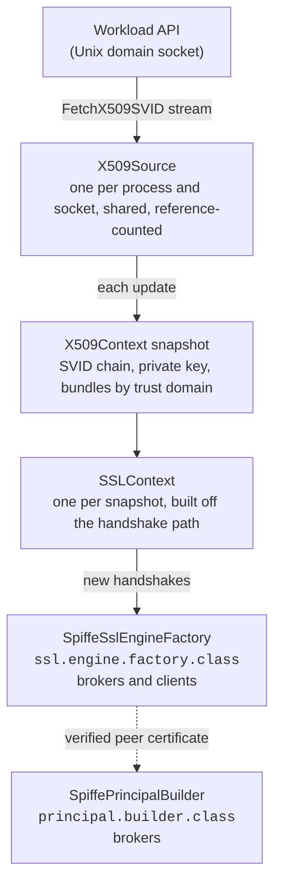

# kafka-spiffe: design

Status: approved. Nothing is implemented yet; the open questions in §10 are answered as the work reaches them.

## 1. Scope

kafka-spiffe is a Java library that gives Apache Kafka brokers and clients, 3.0 and later, mutual TLS based on [SPIFFE](https://spiffe.io/), without files:

- **It talks to the SPIFFE Workload API directly**, over its Unix domain socket, and keeps the workload's X.509-SVID, its private key and the trust bundles (federated ones included) in memory. The Workload API streams rotations, and they take effect without restarting the broker or the client, and without closing the connections that are open.
- **It verifies peers by SPIFFE ID**, never by host name: a client says which broker identities it accepts, a broker which client identities and trust domains.
- **It makes the peer's SPIFFE ID the Kafka principal**, so ACLs (`StandardAuthorizer`) are written against `Spiffe:spiffe://trust-domain/path`.

Out of scope: JWT-SVIDs, SASL, authorization itself (Kafka's authorizer does it, on the principal this library produces), and SPIRE's deployment.

### Why

A typical setup: a Kafka broker in one trust domain (`example.org`, with an SVID of an hour), whose SPIRE server federates with that of a Kubernetes cluster (`k8s.example.org`), where client pods get SVIDs of a few minutes. Without this library, the broker and each client run spiffe-helper, which writes PEM files, and the broker reloads its keystore. That costs a sidecar per workload and private keys on disk; Java clients never reload a keystore at all, so a client outlives its certificate unless it restarts; and the broker's principal is the SVID's subject DN, which says nothing about the workload.

## 2. Architecture



### The Kafka extension points

Three ways to get rotating SPIFFE material into Kafka's TLS were weighed:

| | New SVID on new handshakes | Per-instance policy | Where |
|---|---|---|---|
| **A. `ssl.engine.factory.class`** (chosen) | Yes: each engine comes from the current snapshot's `SSLContext` | Yes: from the config map the factory is given | Brokers, clients, Connect, Streams, CLI tools (`--command-config`) |
| B. A JCA provider with live key and trust managers (`ssl.keymanager.algorithm`, `ssl.trustmanager.algorithm`, `security.providers`) | Yes: the key manager reads the current SVID at each handshake | No: `KeyManagerFactory.init` receives no Kafka configuration, so policy is JVM-wide | Brokers, clients |
| C. PEM files and dynamic broker reconfiguration (today) | Only after the file is rewritten and a reload is triggered | n/a | Brokers only; Java clients do not reload |

**A** is the main path. **B** may ship later as an optional extra over the same core, for places where `ssl.engine.factory.class` cannot be set; its policy would come from a properties file named by a system property.

What A relies on, read from `kafka-clients` 4.3.1 and checked against 3.0.0 and 3.9.1, where all of it is the same unless said otherwise:

- `SslEngineFactory` (extends `Configurable`, `Closeable`): `createClientSslEngine(peerHost, peerPort, endpointIdentification)`, `createServerSslEngine(peerHost, peerPort)`, `shouldBeRebuilt(Map)`, `reconfigurableConfigs()`, `keystore()`, `truststore()`.
- Kafka creates one `SSLEngine` per connection, so a factory that hands out engines from the newest `SSLContext` rotates on every new handshake with no rebuild.
- `SslFactory.reconfigure()` builds a new factory only when `shouldBeRebuilt` says so; its checks for DN and SAN changes (`ssl.allow.dn.changes`, `ssl.allow.san.changes`) and its validating handshake run only when `keystore()` is not null. This factory returns null from `keystore()` and `truststore()`: those checks mean nothing for SVIDs, whose DN changes and whose SAN does not.
- On the inter-broker listener `SslFactory.configure()` validates the factory by a handshake with itself, with an empty peer host. So a broker's client side must accept its own server SVID, and the broker's own ID or trust domain must be allowed (§4).
- The factory is never told which listener it is for: unknown keys such as `spiffe.*` reach it, but a listener-prefixed unknown key (`listener.name.x.spiffe.foo`) arrives still prefixed. Handshake policy is therefore per process; the principal builder, which is told the listener, refines it per listener (§5).
- The factory and the principal builder are created with `Utils.newInstance`, not as `Plugin<>`, so KIP-877 plugin metrics do not reach them. Metrics are JMX MBeans of their own (§7).
- `KafkaPrincipalBuilder` extends `KafkaPrincipalSerde` from 4.0 on. In 3.x it does not, and the channel builders hand the serde on only `if (principalBuilder instanceof KafkaPrincipalSerde)`, so the builder declares both interfaces (§5).
- `kafka-clients` (Java 8 bytecode in 3.x, 11 in 4.x) shades its own protobuf, so it brings nothing this library's dependencies clash with.

### Kafka versions

The floor is Kafka 3.0, for brokers and clients, because Kafka 3.x is still widely run. Everything the library uses has the same shape from 3.0 to 4.3: `ssl.engine.factory.class` (since 2.6), `SslEngineFactory` with the same six methods, `SslFactory` skipping its keystore checks and validating handshake when `keystore()` and `truststore()` are null, `KafkaPrincipalSerde` (since 2.8), and the three authentication contexts. The differences that matter:

| | 3.x | 4.x |
|---|---|---|
| Principal serde | Used only when the builder is an `instanceof KafkaPrincipalSerde` | Part of `KafkaPrincipalBuilder` |
| Authorizer | `AclAuthorizer` on ZooKeeper clusters, `StandardAuthorizer` on KRaft | `StandardAuthorizer` |
| Requests forwarded to a controller | KRaft clusters only | Always |
| JDKs | Clients 8 and later, brokers 11 and later (8 deprecated) | Clients 11 and later, brokers 17 and later |

The library is compiled against `kafka-clients` 3.0.0, so a call into an API added later fails to compile, and tested against 3.x and 4.x (§9). Java 17 bytecode means a 3.x client or broker is served only on Java 17 or later.

### Rotation

- `X509Source` keeps one `FetchX509SVID` stream open. Each update that passes validation becomes an immutable `X509Context`, and an `SSLContext` is built for it on the update thread.
- `createServerSslEngine` and `createClientSslEngine` take the current context. New handshakes use the newest SVID and bundles; open connections keep the session they negotiated and are not touched.
- One `SSLContext` per snapshot: no handshake mixes the key of one snapshot with the trust of another.
- **Sessions are not resumed.** A session timeout counts from each session's creation, so no timeout can keep a session made late in an SVID's life from being resumed after that SVID, or the peer's, has expired, and a resumption checks neither certificate; a TLS 1.3 server's stateless tickets are in no cache that could be swept. Both session contexts therefore time sessions out after one second, the shortest the JDK allows (zero means no limit). Kafka's connections are long-lived, so a full handshake on reconnecting costs little.
- `shouldBeRebuilt` is true only when a `spiffe.*` key, `ssl.enabled.protocols`, `ssl.cipher.suites` or `ssl.client.auth` changed. A rebuilt factory takes the same shared source, so a rebuild is cheap.

## 3. Components

One Bazel package per Java package, under `io.github.bpalermo.kafka.spiffe`:

| Package | Contents | Depends on |
|---|---|---|
| `id` | `SpiffeId`, a strict parser of the SPIFFE ID specification (lowercase trust domain of `[a-z0-9._-]`, path segments of `[A-Za-z0-9._-]`, no empty, `.` or `..` segment, no trailing slash, port, user info, query, fragment or percent-encoding); `TrustDomain`; `SpiffeIdMatcher` (exact IDs, trust domains, path globs where `*` is one whole segment and `**`, last only, one or more trailing segments) | JDK |
| `x509` | `X509Svid`, `X509Bundle`, `BundleSet`, `X509Context` (the snapshot), `SvidLeaf` (the X.509-SVID leaf checks), `SvidValidator` (key matches leaf, validity, leaf constraints, own bundle present, no empty bundle), `SpiffeTrustManager` (per-trust-domain PKIX and the matcher; refusals carry a reason, `PeerRejectedException`), `SnapshotSslContext` | JDK |
| `workload` | `WireReader` (the subset of the protobuf wire format the Workload API needs), `WorkloadApiClient` (`FetchX509SVID` with the `workload.spiffe.io: true` header), `X509Source` (the stream, reconnects with backoff and jitter, rejects a bad update and keeps the current snapshot, listeners, an injectable clock), `X509SourceRegistry` (one source per socket per process, reference-counted), `X509MaterialSource` (the interface another source of material, such as files, can implement) | gRPC, Netty |
| `kafka` | `SpiffeSslEngineFactory`, `SpiffePrincipalBuilder`, `SpiffeConfig` (a `ConfigDef`), `PrincipalMapper` | `kafka-clients` (provided) |
| `kafka.jca` | Optional, later: `SpiffeSecurityProviderCreator` and key and trust manager factories over the same source | `kafka-clients` |
| `metrics` | JMX MBeans, which can be turned off | JDK |

### The Workload API client

The client is our own, not `java-spiffe`:

- The Workload API needs one streaming call and a handful of fields: `X509SVIDResponse` {`svids` = 1, `crl` = 2 (ignored), `federated_bundles` = 3} and `X509SVID` {`spiffe_id` = 1, `x509_svid` = 2, `x509_svid_key` = 3, `bundle` = 4, `hint` = 5}. A hand-written gRPC `MethodDescriptor` and a ~60-line reader of the wire format cover it, with no generated code and no protobuf-java.
- `java-spiffe` brings grpc-protobuf, protobuf-java and nimbus-jose-jwt (for JWT-SVIDs, which are out of scope), and its provider's policy is JVM-wide. It stays as a test oracle: our parser and ID validation are checked against its test cases.

The transport is grpc-java on Netty, with the native epoll transport for Unix domain sockets on linux-x86_64 and linux-aarch_64. Without protobuf that is still guava, perfmark and Netty: about 8–10 MB once shaded, which is accepted for a broker's class path. A client of our own over HTTP/2 and the JDK's Unix domain sockets (`SocketChannel.open(StandardProtocolFamily.UNIX)`) would weigh almost nothing, at the cost of owning HPACK and HTTP/2 framing; it stays the fallback if the relocated epoll transport does not load (phase 0).

## 4. Configuration

Every key starts with `spiffe.`. They are read from the map Kafka passes to `configure()`, validated by a `ConfigDef`, and an unknown `spiffe.*` key is an error, so a typo does not go unnoticed.

### Source

| Key | Meaning | Default |
|---|---|---|
| `spiffe.endpoint.socket` | `unix:///path` of the Workload API. Only `unix:` is accepted | `$SPIFFE_ENDPOINT_SOCKET` |
| `spiffe.svid.hint` | Pick the SVID with this Workload API hint | the first SVID |
| `spiffe.svid.id` | Pick the SVID with this SPIFFE ID | the first SVID |
| `spiffe.startup.timeout.ms` | How long `configure()` waits for the first SVID; `-1` waits for ever, `0` only accepts a source that is already warm | 120000 |
| `spiffe.reconnect.backoff.ms`, `spiffe.reconnect.backoff.max.ms` | Reconnect backoff, with jitter | 500, 30000 |
| `spiffe.bundle.trust.domains` | The bundles to trust, among those the agent delivers. SPIRE already federates per registration entry; this is defence in depth | all |

### Peer verification

| Key | Meaning |
|---|---|
| `spiffe.peer.allowed.ids` | Exact SPIFFE IDs |
| `spiffe.peer.allowed.trust.domains` | Any ID of these trust domains |
| `spiffe.peer.allowed.id.patterns` | Path globs, such as `spiffe://k8s.example.org/ns/*/sa/**`: `*` is one whole segment, `**` (last only) one or more trailing segments, and the trust domain is exact. `web-*` is refused, not matched literally |

At least one of the three is required, on clients and on brokers: there is no implicit "anything a bundle vouches for". A broker also requires `ssl.client.auth=required`, unless `spiffe.server.allow.unauthenticated=true`.

### TLS

- `ssl.protocol`, `ssl.enabled.protocols`, `ssl.cipher.suites`, `ssl.provider` and `ssl.client.auth` are honoured.
- `ssl.endpoint.identification.algorithm` is ignored: host names are never verified (logged once). `ssl.keystore.*` and `ssl.truststore.*` are ignored, with a warning, since setting them suggests a mistake.

### Principal builder

| Key | Meaning | Default |
|---|---|---|
| `spiffe.principal.type` | The principal type: `Spiffe`, or `User` for authorizers and tools that know no other (§5) | `Spiffe` |
| `spiffe.principal.mapping.rules` | `RULE:<regex>/<replacement>/[L\|U], ..., DEFAULT`, the syntax of `ssl.principal.mapping.rules`, applied to the full SPIFFE ID. A string, not a Kafka list: regular expressions contain commas | `DEFAULT` (the ID itself) |
| `spiffe.principal.allowed.ids`, `.trust.domains`, `.id.patterns` | Which peers get a principal, also as `listener.name.<listener>.spiffe.principal.*` | the peer allow-list |
| `spiffe.principal.unmatched` | `deny-principal` (`<type>:spiffe-unauthorized`, which no ACL should name) or `reject` (the connection is refused, offered only if phase 0 shows Kafka closes it cleanly) | `deny-principal` |

### Metrics

`spiffe.metrics.jmx.enabled` (default true), `spiffe.metrics.jmx.domain` (default `kafka.spiffe`).

### Examples

A broker, with the controller on plaintext on the loopback interface:

```properties
listeners=MTLS://0.0.0.0:9093,CONTROLLER://127.0.0.1:9094
listener.security.protocol.map=MTLS:SSL,CONTROLLER:PLAINTEXT
inter.broker.listener.name=MTLS
ssl.client.auth=required
ssl.engine.factory.class=io.github.bpalermo.kafka.spiffe.kafka.SpiffeSslEngineFactory
principal.builder.class=io.github.bpalermo.kafka.spiffe.kafka.SpiffePrincipalBuilder
spiffe.endpoint.socket=unix:///run/spire/agent/sockets/agent.sock
spiffe.peer.allowed.trust.domains=example.org,k8s.example.org
authorizer.class.name=org.apache.kafka.metadata.authorizer.StandardAuthorizer
allow.everyone.if.no.acl.found=false
super.users=Spiffe:spiffe://example.org/kafka/broker;User:ANONYMOUS
```

`User:ANONYMOUS` is a super user only because the controller listener is plaintext and bound to the loopback interface; with SPIFFE on that listener too it goes. The listener is named `MTLS` rather than `SSL` because the `apache/kafka` image's start script asks for JKS files for a listener named `SSL`. The jar goes on the broker's class path through `CLASSPATH`, which `kafka-run-class.sh` honours, or in `libs/`.

A client:

```properties
security.protocol=SSL
ssl.engine.factory.class=io.github.bpalermo.kafka.spiffe.kafka.SpiffeSslEngineFactory
spiffe.endpoint.socket=unix:///spiffe-workload-api/spire-agent.sock
spiffe.peer.allowed.ids=spiffe://example.org/kafka/broker
```

A broker reached by IP address needs no IP SAN: no host name is checked.

## 5. Peer verification and principals

### Verifying a peer

A trust manager per snapshot, on `CertPathValidator` and `PKIXParameters` (so tests can set the clock):

1. The leaf has exactly one URI SAN, a valid SPIFFE ID that is not a trust domain's own ID, is not a CA, and has a key usage with `digitalSignature` and neither `keyCertSign` nor `cRLSign`.
2. The trust domain is that of the leaf's SPIFFE ID, and the chain is validated **against that trust domain's bundle only**. A federated CA (`k8s.example.org`) can never vouch for `spiffe://example.org/...`. Revocation is not checked (SVIDs are short-lived), and a root the peer sends along is dropped before validation.
3. A leaf with an extended key usage must allow the purpose: `serverAuth` for a broker, `clientAuth` for a client.
4. The ID is matched against the allow-list.

A refusal carries its reason (malformed SVID, unknown trust domain, chain, ID not allowed), which the metrics count (§7). The trust manager names no accepted issuers, so a broker asks for a client certificate without listing authorities, and a client whose SVID comes from an intermediate the broker does not hold still presents it: which authorities count is decided per trust domain by the verifier.

Every engine has `setEndpointIdentificationAlgorithm(null)`. There is no fallback to host-name verification anywhere.

### The principal

`SpiffePrincipalBuilder.build(context)`:

- **TLS** (`SslAuthenticationContext`): reads the leaf from `session.getPeerCertificates()`, parses its SPIFFE ID again, strictly (nothing is carried over from the handshake), applies the per-listener allow-list and the mapping rules, and returns `new KafkaPrincipal(type, name)`, by default `Spiffe:spiffe://k8s.example.org/ns/foo/sa/bar`. It never looks at the subject DN or CN, and never returns `ANONYMOUS`. A client that sent no certificate is treated as unmatched.
- **Plaintext** (`PlaintextAuthenticationContext`): `KafkaPrincipal.ANONYMOUS`, as Kafka's default builder does, for a plaintext controller listener.
- **SASL** (`SaslAuthenticationContext`): delegated to Kafka's default builder, since `principal.builder.class` applies to every listener.

A broker forwards requests to the controller with the principal serialized, so the builder is also a `KafkaPrincipalSerde`. It declares both interfaces, `implements KafkaPrincipalBuilder, KafkaPrincipalSerde`: in 4.x the first already extends the second, and in 3.x a builder that does not declare it gets no serde and its forwarded requests fail. `serialize` and `deserialize` delegate to Kafka's `DefaultKafkaPrincipalBuilder`, and the builder returns plain `KafkaPrincipal`s, never a subclass, so the authorizer sees the same principal whether a request was forwarded or not.

### The principal type

A Kafka principal is a type and a name, and Kafka's own authorization does not require the type to be `User`. The default is a type of its own, `Spiffe`, because under `User` a SPIFFE ID shares a namespace with every SASL user: a SCRAM or PLAIN user named `spiffe://k8s.example.org/ns/foo/sa/bar`, on another listener of the same broker, would match every ACL written for that workload. Under `Spiffe` only a verified X.509-SVID produces those principals, and the type says, in ACL listings, `super.users` and the authorizer's log, where an identity came from. The name is the full SPIFFE ID under either type, so it is a valid SPIFFE ID copied from a registration entry, and changing the type does not change the name.

What Kafka does with a type other than `User`, read in the source of 4.3.1, 3.9.1 and 3.0.0, which agree:

| Where | Behaviour |
|---|---|
| ACLs: `kafka-acls.sh`, the Admin API, the controller | The principal string is split at its first `:` (`SecurityUtils.parseKafkaPrincipal`; `AclControlManager` checks only that there is a colon). Any type is accepted. |
| `StandardAuthorizer`, and `AclAuthorizer` on 3.x ZooKeeper clusters | An ACL matches when its principal equals the session's (type and name), or is `User:*`. `User:*` therefore matches principals of every type, `Spiffe` included. |
| `super.users` | Parsed the same way, and compared with the session principal (as a string by `StandardAuthorizer`, as a `KafkaPrincipal` by `AclAuthorizer`), so `Spiffe:spiffe://…` works. |
| Forwarding to the controller | `DefaultKafkaPrincipalBuilder.serialize` writes the type and the name, so a forwarded request keeps its type. ZooKeeper clusters forward nothing. |
| Client quotas | Keyed by the principal's name only, the type dropped: a quota for user `spiffe://…` applies under either type, and is shared with a SASL user of the same name. |
| Delegation tokens | A token's owner can be of any type; its renewers must be `User` (`INVALID_PRINCIPAL_TYPE`). A workload with an SVID has no use for a token. |

`User` remains for authorizers and operators that understand no other type, such as Confluent's RBAC, Apache Ranger, or ACLs generated by Strimzi's `KafkaUser`. The OPA plugin is given the type and can match either.

### ACLs

- `ssl.principal.mapping.rules` is used only by Kafka's default builder, so it has no effect once this one is configured; a value other than `DEFAULT` is logged as a warning.
- `StandardAuthorizer` matches principals literally (the only wildcard is `User:*`, which matches every type). A group of workloads, such as a Kubernetes namespace, is one principal only through a mapping rule: `RULE:^spiffe://k8s\.example\.org/ns/payments/sa/.*$/spiffe-group:k8s.example.org:payments/`.
- A rule that drops the trust domain lets one trust domain produce the principal of another; such a rule is warned about at configuration time.
- `kafka-acls.sh --add --allow-principal 'Spiffe:spiffe://k8s.example.org/ns/foo/sa/bar' --operation Read --topic orders` works: Kafka splits a principal at its first `:`. `super.users` is separated by `;`.

### A peer that gets no principal

A peer whose certificate verifies but that the principal allow-list does not cover gets `Spiffe:spiffe-unauthorized` (or `User:spiffe-unauthorized` under `spiffe.principal.type=User`). Its connection stays open and every request it makes is refused by the authorizer, so its client reports an authorization error (`TopicAuthorizationException`, `ClusterAuthorizationException`) instead of a connection that closes with no reason given, and the broker logs the peer's real SPIFFE ID once, at a limited rate, with the rule it failed. That is why it is the default. Two settings undo it, and both are warned about at startup: an ALLOW ACL on `User:*`, which matches principals of every type, and `allow.everyone.if.no.acl.found=true`. `reject`, if phase 0 shows Kafka closes the connection as an authentication failure, keeps such peers out whatever the ACLs say.

## 6. Failure and expiry

- **At startup** `configure()` takes the shared source and waits for its first usable SVID up to `spiffe.startup.timeout.ms`, then throws a `KafkaException`: the broker does not start, a client's constructor fails. Later factories in the same process (a broker makes one per listener) return at once.
- **The stream breaks** (`UNAVAILABLE`, closed): the last good snapshot stays in use, and the source reconnects with backoff and jitter.
- **`PERMISSION_DENIED`**: the agent has no registration entry for this workload yet. Retried, with a warning that says so.
- **`INVALID_ARGUMENT`**: not retried; an error log and a metric.
- **An update that fails validation** (no SVID, key not matching the leaf, leaf not valid now, malformed ID, empty bundle) is rejected, and the current snapshot stays.
- **Expiry.** A gauge of the SVID's remaining lifetime; a warning when no rotation has come by two thirds of it (SPIRE rotates at about half), an error once it has expired. What happens after that is described below, and still open (§10).
- **Open connections are not re-authenticated.** Kafka re-authenticates only SASL connections (`connections.max.reauth.ms`): a peer authenticated with an SVID that has since expired keeps its connection and principal until it disconnects.

### An SVID that expires

The SVID expires only when the Workload API has been out of reach for the second half of its lifetime: SPIRE rotates at about half, so half an hour for a broker's one-hour SVID, a few minutes for a client's short one. The agent restarting, the socket's mount going away, or the workload's registration entry being deleted all lead there. Startup never gets that far: `configure()` accepts only an SVID that is valid now. While it lasts:

- Open connections carry on. TLS checks the certificate at the handshake only, and Kafka does not re-authenticate TLS connections.
- New handshakes cannot succeed in either case below, since every correct peer refuses an expired certificate. The question is only where the failure shows, and how.
- Either way the source keeps reconnecting, and the first new SVID ends it, with no restart: new engines come from the new snapshot, and Kafka clients reconnect on their own backoff.

The two behaviours:

| | **Keep presenting it** (current default) | **Fail engine creation** (`spiffe.svid.expired=fail`) |
|---|---|---|
| A client whose SVID expired | The broker refuses the handshake; the client logs an SSL handshake failure (`certificate_expired` alert) and retries | The client fails the connection before connecting, with our message (`SVID spiffe://… expired at …, Workload API unreachable since …`), and retries |
| A broker whose SVID expired | Each client logs that the broker's certificate expired; the broker logs the failed handshakes | The broker closes each accepted connection before any TLS, which clients see as a disconnect with no alert; the broker logs our message per connection, at a limited rate |
| Where the cause is visible | At the peer, as a standard TLS error; locally through our error log, the gauge and the metric | Locally, in our message; at the peer, only on the client side |
| What Kafka does with it | A failed handshake: a path every deployment already exercises | An exception from `createClientSslEngine` / `createServerSslEngine` inside the channel builder: not verified that it fails only that connection (phase 0) |
| A peer whose clock is behind | Accepts the SVID for as long as its clock lags | Nothing is presented |

Neither weakens security: an expired SVID is refused by any peer with a correct clock, and its key is still the workload's own. Keeping it changes nothing on the Kafka side and recovers the same way; failing gives a clearer message where the problem is, and on a broker a less clear one for its clients.

Threads: one daemon event-loop thread per socket; a source closes when the last factory using it is closed.

## 7. Observability

JMX MBeans, which the Prometheus JMX exporter on a broker picks up:

- `kafka.spiffe:type=x509-source,socket=<path>`: `connected`, `updates-total`, `updates-rejected-total`, `stream-errors-total`, `last-update-timestamp-ms`, `svid-expiry-timestamp-ms`, `svid-ttl-remaining-ms`, `bundle-count`, `bundle-trust-domains`.
- `kafka.spiffe:type=peer-verification,mode=server|client`: `accepted-total`, and `rejected-total` by reason (unknown trust domain, chain, ID not allowed, malformed SVID).

Logs go through slf4j, which Kafka provides: SPIFFE IDs, trust domains, expiry times, socket paths; never keys. Rejected peers are logged at a limited rate.

## 8. Security

1. No fallback to host names: an empty allow-list is a configuration error, on both sides.
2. A trust domain's bundle verifies only that trust domain's IDs, so federation cannot be used to forge an identity of another trust domain.
3. Leaves are checked as the X.509-SVID specification requires; intermediates by ordinary PKIX, under the JDK's `jdk.certpath.disabledAlgorithms`.
4. The principal comes only from the verified leaf's URI SAN, parsed strictly: non-canonical IDs (an uppercase trust domain, `//`, `/./`) are refused, so they cannot look like an ID an ACL names.
5. Key, chain and trust come from one snapshot, and sessions are not resumed, so every connection's certificates are checked when it is made.
6. The algorithm constraints a connection's `SSLParameters` carry are applied to the peer's chain: the JDK adds no checks around an `X509ExtendedTrustManager`, and PKIX alone applies only `jdk.certpath.disabledAlgorithms`.
7. The private key is only in memory: never on disk, never in Kafka's configuration (where an inline PEM key set through `AlterConfigs` would end up in the KRaft metadata log).
8. The Workload API is reached only over a Unix domain socket, whose file permissions are the deployment's to set.
9. The inter-broker validation handshake needs the broker's own ID allowed; that is not a reason to allow everything.
10. The principal type `Spiffe` keeps SASL users, whose names an administrator sets, from matching the ACLs of a SPIFFE ID. Quotas, keyed by name alone, are still shared with a SASL user of the same name.
11. A peer that gets no principal is kept out by ACLs alone (§5): an ALLOW ACL on `User:*` or `allow.everyone.if.no.acl.found=true` lets it in.
12. `User:ANONYMOUS` as a super user makes anyone who reaches that listener a super user: bind a plaintext controller listener to the loopback interface.

## 9. Build, testing and packaging

### Build

A Bazel (bzlmod) repository: hermetic JDKs, `-Xlint:all -Werror`, Error Prone, PMD, google-java-format, JUnit on the console launcher, pinned Maven dependencies through rules_jvm_external. gRPC and Netty come from Maven; there are no protos to compile.

**Bytecode: Java 17** (`--java_language_version=17`, compiled against the JDK 17 runtime so later APIs fail to compile). Java 17 is the oldest LTS a Kafka 4 broker runs on. Clients on Java 8 or 11, which Kafka 3.x and 4.x clients still allow, are not served, nor 3.x brokers on Java 11.

**`kafka-clients` 3.0.0** at compile time (provided, never shipped), so nothing newer is called by accident.

### Tests

- **Unit**: the SPIFFE ID parser against the specification's cases and `java-spiffe`'s; matchers; the wire reader against bytes written by protobuf's `CodedOutputStream` (a test-only dependency) and recorded SPIRE responses; `SvidValidator` and `SpiffeTrustManager` with certificates generated in the test (BouncyCastle, test-only: CA leaves, several URI SANs, wrong key usage, expired chains), at a set clock; mapping rules; the serde against `DefaultKafkaPrincipalBuilder`.
- **A fake Workload API**: a gRPC server on a Unix socket that checks the security header and pushes publications, and can be told to fail (`PERMISSION_DENIED`, `UNAVAILABLE`, a closed stream), to delay, to serve several SVIDs with hints, and to change federated bundles.
- **Engine pairs**, no broker: a client and a server `SSLEngine` from two factories, each on its own fake Workload API, handshaking in memory. Allowed and refused by ID, trust domain and pattern; a `k8s.example.org` client against an `example.org` broker, and a forged cross-trust-domain chain refused; a rotation, after which the next handshake presents the new SVID while the old session goes on, with no rebuild; bundle rotation; a federated bundle withdrawn; expiry; the validation handshake with an empty peer host.
- **Kafka**: an in-process broker, with broker and client on fake Workload APIs and ACLs on `Spiffe:spiffe://…` (and one on `User:`, for the setting); producing and consuming across client and broker rotations (SVIDs of seconds) with no new connections (`connection-creation-total`); the inter-broker listener on TLS; on KRaft, a request forwarded to the controller, for the serde; on ZooKeeper, `AclAuthorizer`. The same tests run on each Kafka version of the matrix below, and a client of one version against a broker of another (a 3.x client and a 4.x broker, and the reverse).
- **End to end** (tagged `e2e`): two real SPIRE servers, federated, with agents; an `apache/kafka` broker (the newest 3.x and 4.x images) with only the shaded jar added; a client container; 60-second SVIDs, so the run sees several rotations.
- **The shaded jar**: a handshake with only `kafka-spiffe-all` and `kafka-clients` on the class path; no unrelocated `io/netty`, `io/grpc` or `com/google` classes; the relocated epoll library loads.

### CI matrix

Each JDK runs only where the Kafka version supports it, so the matrix is not a full product:

| Job | JDK | Kafka |
|---|---|---|
| Unit and engine pairs | 17, 21, 25 | (none) |
| Broker tests, KRaft | 17 and 25 on 4.x; 17 on 3.x | 3.3, the first with production KRaft; 3.9; 4.0; the newest 4.x |
| Broker tests, ZooKeeper (`AclAuthorizer`) | 17 | 3.0, 3.9 |
| Clients across versions | 17 | a 3.0 client and a newest 4.x broker; a newest 4.x client and a 3.9 broker |
| End to end | the image's | newest 3.x and 4.x images |
| The shaded jar | 17 | 3.0, the newest 4.x |

Each Kafka version is its own `maven.install` repository, so the tests of one version never see another's jars; the library is built once, against 3.0.0. Which 3.x versions run on JDK 21 and 25 is phase 0's to find out; 17 is supported by all of them.

### Packaging

- `io.github.bpalermo:kafka-spiffe`: the library, with gRPC and Netty as ordinary dependencies, and `kafka-clients` (3.0 or later) and `slf4j-api` provided. For applications that manage gRPC and Netty themselves.
- `io.github.bpalermo:kafka-spiffe-all`: shaded, for a broker's class path. `io.grpc`, `io.netty`, `com.google.common`, `com.google.thirdparty`, `io.perfmark` and `com.google.errorprone.annotations` are relocated under `io.github.bpalermo.kafka.spiffe.shaded`; `org.apache.kafka` and `org.slf4j` are not. The epoll native libraries are renamed to the relocated prefix Netty looks for, and gRPC's service files relocated (or the channel built without ServiceLoader).
- Published to Maven Central, and the shaded jar as a release asset, signed with cosign. `Automatic-Module-Name` in the manifest. Semantic versioning; Kafka 3.0 is the floor, and raising it is a major version.

## 10. Plan

0. **Spike**, to settle what was not verified:
   - what Kafka does with a connection when `KafkaPrincipalBuilder.build` throws: closed as an authentication failure, or not (decides whether `reject` is offered);
   - what Kafka does with a connection when `createClientSslEngine` or `createServerSslEngine` throws: only that connection fails, or more (decides whether `spiffe.svid.expired=fail` is offered);
   - whether `kafka-configs --alter` accepts `listener.name.X.spiffe.*` as dynamic configuration;
   - whether `listener.name.X.principal.builder.class` is honoured;
   - a `Spiffe` principal end to end: an ACL added with `kafka-acls.sh`, a super user, and a request forwarded to the controller (the source says all three work; this runs them);
   - grpc-netty's epoll transport relocated and loading in the shaded jar (if not, our own HTTP/2 client over the JDK's Unix sockets);
   - which in-process test clusters are published and usable: KRaft for 3.3 to 4.x, ZooKeeper for 3.x;
   - which JDKs each 3.x version runs on (17 for all; 21 and 25 for some), and whether the `apache/kafka` images, published from 3.7, are enough for the end-to-end 3.x run;
   - what a Kafka 3.x and 4.x distribution's `libs/` holds (Netty, Guava).
1. The repository: `MODULE.bazel` (one Maven repository per Kafka version), `.bazelrc` (Java 17, the JDK matrix), lint, the JUnit macro, CI, `AGENTS.md`.
2. `id` and `x509`, with their tests. Done.
3. `workload`: the reader, the client, `X509Source`, the registry, the fake Workload API, backoff and expiry, JMX.
4. `SpiffeSslEngineFactory`: client and server, configuration, engine-pair and rotation tests.
5. `SpiffePrincipalBuilder`: serde, mapping rules, per-listener policy, an authorizer test.
6. The shaded jar and its test, publishing, the operator's documentation (broker and client configuration, ACL migration).
7. End to end with federated SPIRE, and a migration guide from spiffe-helper: ACLs for the new principals first, then the broker, then the clients one at a time.
8. Later, optional: the JCA provider; allow-lists changed at run time through `reconfigurableConfigs`.

### Decided

- **Java 17 bytecode**, tested on every LTS up to the latest. Java 8 and 11 clients are not served.
- **Kafka 3.0 and later**, brokers and clients, ZooKeeper and KRaft, tested on each (§9).
- **The shaded jar's size** (about 10 MB) is acceptable, so the transport is grpc-java on Netty.
- **The principal** is the full SPIFFE ID, of type `Spiffe` (§5). Grouping workloads is done with mapping rules.
- **A peer that gets no principal** gets `Spiffe:spiffe-unauthorized` by default: an authorization error is clearer to its owner than a closed connection (§5).
- Deployment questions (a particular broker's listeners, SPIRE agent socket, attestation and federation) belong to the deployment, not to this design.
- Other projects adopting the library do so once it is published, in their own repositories.

### Open questions

1. **An expired SVID** (§6): keep presenting it, the current default, or fail engine creation? Keeping it is what any TLS stack does and needs nothing verified on the Kafka side; failing names the cause where it is, and is offered only if phase 0 shows an exception from the engine factory fails just that connection. The proposal: keep it as the default, and offer `fail` if phase 0 allows.
