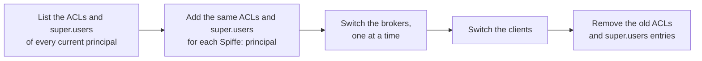

# Operating kafka-spiffe

How to run Kafka brokers and clients with kafka-spiffe: installing the jar, configuring a broker and its clients, writing ACLs for SPIFFE principals, moving existing ACLs over, and what to watch. The reasons behind each behaviour are in the [design](design.md).

What you need:

- **Kafka:** 3.0 or later, brokers and clients, ZooKeeper or KRaft.
- **Java:** 17 or later, on brokers and clients alike.
- **SPIFFE:** a SPIRE agent (or any Workload API) on a Unix domain socket the process can reach. That means Linux, Alpine included, or macOS; SPIRE on Windows uses a named pipe, which is not served.
- **Registration:** an entry for each workload, so the agent gives it an X.509-SVID. A broker and its clients may be in different trust domains, federated, as long as the agent delivers the other trust domain's bundle.

## Installing

The artifact is `io.github.bpalermo:kafka-spiffe`, one jar for brokers and clients. It bundles nothing and has no dependency of its own: `kafka-clients` and `slf4j-api` come from whoever runs it.

- **Application:** add the dependency next to your `kafka-clients`.
  ```xml
  <dependency>
    <groupId>io.github.bpalermo</groupId>
    <artifactId>kafka-spiffe</artifactId>
    <version>${kafka-spiffe.version}</version>
  </dependency>
  ```
- **Broker, or Kafka's command-line tools:** put the jar on the class path. Either copy it into the distribution's `libs/` directory, or name it in `CLASSPATH`, which `kafka-run-class.sh` honours:
  ```sh
  export CLASSPATH=/opt/kafka-spiffe/kafka-spiffe.jar
  bin/kafka-server-start.sh config/server.properties
  ```
- **The `apache/kafka` image:** mount the jar, set `CLASSPATH`, and give the `spiffe.*` keys as environment variables. The image turns `KAFKA_SPIFFE_PEER_ALLOWED_TRUST_DOMAINS` into `spiffe.peer.allowed.trust.domains`: drop `KAFKA_`, lowercase, `_` becomes `.`, and `__` becomes `_`.

Every release on GitHub carries the jar and its POM with a cosign bundle, and Maven Central has them signed with the release key (see [Verifying a release](#verifying-a-release)).

## The broker

A broker needs three things:

- `ssl.engine.factory.class`, which takes its key, certificate and trust from the Workload API;
- `principal.builder.class`, which makes the client's SPIFFE ID its principal;
- a peer allow-list, which says who may connect at all.

The broker below has its client and inter-broker traffic on mutual TLS and the controller on plaintext, bound to the loopback interface:

```properties
listeners=MTLS://0.0.0.0:9093,CONTROLLER://127.0.0.1:9094
listener.security.protocol.map=MTLS:SSL,CONTROLLER:PLAINTEXT
inter.broker.listener.name=MTLS
ssl.client.auth=required
ssl.engine.factory.class=io.github.bpalermo.kafka.spiffe.kafka.SpiffeSslEngineFactory
principal.builder.class=io.github.bpalermo.kafka.spiffe.kafka.SpiffePrincipalBuilder
spiffe.endpoint.socket=unix:///run/spire/agent/sockets/agent.sock
spiffe.peer.allowed.trust.domains=example.org,k8s.example.org
authorizer.class.name=org.apache.kafka.metadata.authorizer.StandardAuthorizer
allow.everyone.if.no.acl.found=false
super.users=Spiffe:spiffe://example.org/kafka/broker;User:ANONYMOUS
```

- **The peer allow-list** (`spiffe.peer.allowed.*`) is checked in the TLS handshake: a peer outside it never connects.
  - It is required. There is no default that trusts whatever the bundles vouch for.
  - On a broker it covers the clients and the other brokers, so the broker's own ID must be in it. The handshake Kafka runs to validate a broker's own TLS setup needs that too.
  - Allow by exact ID (`spiffe.peer.allowed.ids`), by trust domain (`spiffe.peer.allowed.trust.domains`), or by path pattern (`spiffe.peer.allowed.id.patterns`, such as `spiffe://k8s.example.org/ns/*/sa/**`). In a pattern, `*` is one whole path segment and `**`, last only, one or more.
- **`ssl.client.auth=required`.** A broker refuses to start without it, unless `spiffe.server.allow.unauthenticated=true`.
- **Host names are never checked.** `ssl.endpoint.identification.algorithm` is ignored, so a broker reached by IP address needs no IP SAN.
- **Keystores and truststores are ignored.** `ssl.keystore.*` and `ssl.truststore.*` are logged as a mistake.
- **TLS settings that are honoured:** `ssl.protocol`, `ssl.enabled.protocols`, `ssl.cipher.suites`, `ssl.provider` and `ssl.client.auth`.
- **Keep `SSL` out of the end of the listener's name.** The `apache/kafka` image's start script asks for JKS files whenever `KAFKA_ADVERTISED_LISTENERS` contains `SSL://`. That catches `SSL`, but also `EXTERNAL_SSL` and `SASL_SSL`. A name such as `MTLS`, as in the example, avoids it.
- **`User:ANONYMOUS` as a super user** is there only because the controller listener is plaintext and bound to the loopback interface. Anyone who reaches a plaintext listener is `ANONYMOUS`. With SPIFFE on the controller listener too, drop it.
- **`spiffe.*` keys are static.** Set them in the properties file (or the image's environment), never with `kafka-configs --alter`: a running broker does not apply them.
- **No per-listener form.** Do not write `listener.name.<listener>.spiffe.*`; it does not exist. The library refuses it when it sees it, but Kafka can drop it unseen when the same key is also set without the prefix. Per-listener principal settings have their own keys ([below](#a-listener-of-its-own)).

### Startup

`configure()` waits for the first valid SVID, up to `spiffe.startup.timeout.ms` (two minutes by default; `-1` waits for ever). If none comes, the broker does not start, with `no X.509 SVID from the Workload API at <socket> within <timeout>: …`.

The usual causes are:
- a wrong socket path;
- an agent that cannot be reached;
- a workload with no registration entry. The agent answers `PERMISSION_DENIED`, which is logged as `The Workload API at <socket> has no SVID for this workload yet (…): is it registered?`.

## Clients

A client names the broker identities it accepts:

```properties
security.protocol=SSL
ssl.engine.factory.class=io.github.bpalermo.kafka.spiffe.kafka.SpiffeSslEngineFactory
spiffe.endpoint.socket=unix:///spiffe-workload-api/spire-agent.sock
spiffe.peer.allowed.ids=spiffe://example.org/kafka/broker
```

- **Applications:** the same keys go in the producer, consumer and admin client configuration.
- **Command-line tools:** put them in a file passed with `--command-config` (or `--producer.config`, `--consumer.config`), with the jar in `CLASSPATH`.
- **Kafka Streams:** an application gives the keys once, unprefixed, and they reach every client it makes.
- **Kafka Connect:** a worker's configuration needs the keys twice.
  - **Unprefixed:** for the worker's own clients, those of its internal topics and the connectors' admin clients.
  - **Prefixed:** again with `producer.` and `consumer.`, for the tasks' clients, such as `producer.ssl.engine.factory.class` and `consumer.spiffe.endpoint.socket`.
- **`SPIFFE_ENDPOINT_SOCKET`:** when `spiffe.endpoint.socket` is not set, this environment variable is used. A SPIRE deployment that sets it for its workloads needs no socket key at all.

**Rotation needs no action.** A new SVID or bundle takes effect for every new connection, in brokers and clients, without a restart; open connections keep the session they made.

### The same SVIDs outside Kafka

An application whose other servers or clients need the SVIDs and bundles its Kafka clients use can take them from the library, on the same Workload API stream, instead of opening its own:

```java
SpiffeConfig config = SpiffeConfig.parse(kafkaClientConfig, System.getenv());
X509MaterialSource source = config.acquireSource(); // closed when the application stops
source.awaitFirst(Duration.ofMinutes(1));
SnapshotSslContext.Settings tls = new SnapshotSslContext.Settings("TLSv1.3", null);

// For each new connection: the newest snapshot, so a rotation is never missed.
SSLContext context =
    SnapshotSslContext.create(source.current(), config.peers(), tls, Clock.systemUTC());
X509MaterialSource.Stats stats = source.stats(); // connected, updates, rejected, stream errors
```

`acquireSource()` returns a handle on the source an engine factory configured with the same `spiffe.*` keys uses, so the two share one stream and see the same snapshots. Reading `current()` when a connection is made, as the engine factory does, needs nothing else; an application that would rather be told of each new snapshot adds a listener and then reads `current()` once, since a listener is not called with the snapshot already there. Closing the handle removes its listeners. These types are the library's public API (design, section 3).

## Principals and ACLs

A client's principal is its full SPIFFE ID, under the type `Spiffe`: `Spiffe:spiffe://k8s.example.org/ns/payments/sa/api`. ACLs and `super.users` name it like any other principal:

```sh
kafka-acls.sh --bootstrap-server broker:9093 --command-config admin.properties \
  --add --allow-principal 'Spiffe:spiffe://k8s.example.org/ns/payments/sa/api' \
  --operation Read --topic orders --group payments
```

- **Why the type is `Spiffe`, not `User`.** A SASL user is named by whoever creates it. Under `User`, a SCRAM or PLAIN user called `spiffe://k8s.example.org/ns/payments/sa/api` would match that workload's ACLs; under `Spiffe` only a verified SVID gets those principals.
  - Set `spiffe.principal.type=User` only for an authorizer or tool that knows no other type, such as Apache Ranger, Confluent RBAC or Strimzi's `KafkaUser` ACLs.
  - Client quotas are keyed by the principal's name alone, so a quota is shared with a SASL user of the same name whichever type is used.
- **`super.users`** is separated by `;`, and Kafka splits each principal at its first `:`, so `Spiffe:spiffe://…` needs no quoting.
- **SASL and plaintext listeners on the same broker** are unaffected. A SASL listener gets the principals Kafka's own builder would give, Kerberos short names included, and a plaintext one gets `User:ANONYMOUS`.
- **Kafka's `ssl.principal.mapping.rules` has no effect** once this builder is configured; setting it is logged as a warning. The mapping rules are `spiffe.principal.mapping.rules`, below.

### Grouping workloads

Kafka's authorizers match principals exactly, so ACLs for many workloads mean either one ACL per SPIFFE ID or a mapping rule that gives a group of them one principal.

`spiffe.principal.mapping.rules` has the syntax of Kafka's `ssl.principal.mapping.rules`, applied to the whole SPIFFE ID. A `/` inside a rule's expression or replacement is written `\/`.

In a properties file, write every backslash twice. Kafka reads the file with `java.util.Properties`, which treats a backslash as an escape: a rule written `\/` would reach the library as `/` and no longer parse.

The same goes for the `apache/kafka` image's environment variables. The image writes them as they are into `server.properties`, which Kafka then reads the same way. Mind your own quoting on top of that:
- a YAML single-quoted string, or a shell argument in single quotes, passes backslashes through unchanged;
- double quotes in a shell turn `\\` into `\`.

For example, in a Compose file:

```yaml
environment:
  KAFKA_SPIFFE_PRINCIPAL_MAPPING_RULES: 'RULE:^spiffe:\\/\\/k8s\\.example\\.org\\/ns\\/payments\\/sa\\/.*$/spiffe-group:k8s.example.org:payments/, DEFAULT'
```

In a properties file:

```properties
spiffe.principal.mapping.rules=RULE:^spiffe:\\/\\/k8s\\.example\\.org\\/ns\\/payments\\/sa\\/.*$/spiffe-group:k8s.example.org:payments/, DEFAULT
```

Every service account of the namespace `payments` is then `Spiffe:spiffe-group:k8s.example.org:payments`, and other IDs keep their own (`DEFAULT`).

- **Keep the trust domain in the name.** A rule that drops it lets two trust domains produce the same principal. The first time a rule maps an ID to a name without its trust domain, the broker logs a warning naming both.
- **An ID that no rule maps** gets the unauthorized principal (below).

### Who gets a principal

By default every peer the handshake accepts gets its principal. `spiffe.principal.allowed.ids`, `.trust.domains` and `.id.patterns` narrow that.

A peer that connects but is outside them gets `Spiffe:spiffe-unauthorized`:
- its connection stays open, and every request is refused by the authorizer;
- its owner sees an authorization error, such as `TopicAuthorizationException`, rather than a connection that closes with no reason;
- the broker logs the peer's real SPIFFE ID, at a limited rate.

```properties
spiffe.peer.allowed.trust.domains=example.org,k8s.example.org
spiffe.principal.allowed.id.patterns=spiffe://k8s.example.org/ns/*/sa/*
```

Two settings let `spiffe-unauthorized` in after all; keep both out of your configuration:

- **An ALLOW ACL on `User:*`.** Kafka's authorizers match it against principals of *every* type, `Spiffe` included.
- **`allow.everyone.if.no.acl.found=true`.** It lets every principal reach every resource that has no ACL. The broker logs a warning when it is set.

To keep a workload out whatever the ACLs say, leave it out of the *peer* allow-list. It then cannot connect at all.

### A listener of its own

`spiffe.principal.listener.<listener>.allowed.ids`, `.trust.domains` and `.id.patterns` replace the three `spiffe.principal.allowed.*` keys on one listener:
- the listener name is not case-sensitive;
- spelling one listener two ways is an error.

For example, an `INTERNAL` listener only for brokers:

```properties
spiffe.peer.allowed.trust.domains=example.org,k8s.example.org
spiffe.principal.listener.internal.allowed.ids=spiffe://example.org/kafka/broker
```

## Moving existing ACLs over

A cluster that today authenticates the same SVIDs through files has principals of another shape, usually `User:` followed by the certificate's subject DN. Those files are PEM written by spiffe-helper and loaded as a keystore and truststore, and the principal comes from Kafka's default builder or its `ssl.principal.mapping.rules`.

Switching the principal builder changes every principal at once, so add the new ACLs before the switch and remove the old ones after it:



1. **List what exists:** `kafka-acls.sh --list`, and `super.users` in every broker's configuration. Write down which SPIFFE ID each old principal stands for: the workload whose SVID carried that subject.
2. **Add the new ACLs**, one `Spiffe:<SPIFFE ID>` (or one group principal from a mapping rule) for each old principal, with the same operations and resources. Add the brokers' SPIFFE IDs to `super.users` beside the old entries. Until the last broker is switched, a broker may see another broker under either name.
3. **Switch the brokers** one at a time, with a rolling restart:
   - **What changes:** each broker gets the jar, `ssl.engine.factory.class`, `principal.builder.class`, the `spiffe.*` keys, and no keystore or truststore.
   - **Old clients keep working.** Their certificates are SVIDs too, so a switched broker verifies them by SPIFFE ID and gives them `Spiffe:` principals, which the new ACLs cover.
4. **Switch the clients**, in any order: each needs the jar and its `spiffe.*` keys instead of a keystore and truststore.
5. **Check the authorizer's log for denials**, then remove the old ACLs and `super.users` entries.

A broker that has not been switched yet still needs a truststore holding every trust domain its clients come from. A switched broker needs only its agent to deliver those bundles.

## Watching it

### JMX

Each Workload API connection registers one MBean, `kafka.spiffe:type=x509-source,socket="<socket path>"`:
- **One per socket:** a process has one connection per socket, however many factories use it.
- **More keys in the name:** a source that sets `spiffe.svid.hint`, `spiffe.svid.id` or `spiffe.bundle.trust.domains` adds `svid-hint`, `svid-id` or `bundles` to the name.
- **Settings:** `spiffe.metrics.jmx.domain` changes the domain, and `spiffe.metrics.jmx.enabled=false` turns the MBeans off.

| Attribute | Meaning |
|---|---|
| `connected` | Whether the stream to the Workload API is open |
| `updates-total` | Responses that replaced the SVID and bundles |
| `updates-rejected-total` | Responses refused (no SVID, a key that does not match, a leaf not valid now, an empty bundle); the previous SVID stays |
| `stream-errors-total` | Times the stream ended or could not be opened |
| `last-update-timestamp-ms` | When the SVID and bundles were last replaced, or -1 |
| `svid-expiry-timestamp-ms` | When the SVID expires, or -1 |
| `svid-ttl-remaining-ms` | How long until it expires; negative once it has |
| `bundle-count`, `bundle-trust-domains` | The trust domains with a bundle, and their names |

Every process also counts the peers its handshakes accepted and refused, in two MBeans per JMX domain:
- `kafka.spiffe:type=peer-verification,mode=server`, for handshakes in which it verified a client (a broker's clients and the other brokers);
- `mode=client`, for those in which it verified a broker.

The counts cover every factory of the process and only grow.

| Attribute | Meaning |
|---|---|
| `accepted-total` | Peers accepted |
| `rejected-total` | Peers refused, for any reason |
| `rejected-malformed-svid-total` | No certificate, or a leaf that is not a valid X.509-SVID |
| `rejected-unknown-trust-domain-total` | A trust domain the agent delivered no bundle for |
| `rejected-chain-total` | A chain that does not verify against its trust domain's bundle, or not for this purpose |
| `rejected-id-not-allowed-total` | A valid SVID whose ID the peer allow-list does not cover |

The Prometheus JMX exporter on a broker picks the MBeans up with `includeObjectNames: ["kafka.spiffe:*"]` added to its configuration. Worth an alert:

- `svid-ttl-remaining-ms` below a third of the SVID's lifetime. SPIRE rotates at about half, so a rotation is overdue.
- `connected` at 0 for more than a few minutes.
- `updates-rejected-total` increasing.
- `rejected-total` of `mode=server` increasing: workloads trying to connect that the allow-list or the bundles do not let in.

### Logs

Logs go through slf4j, so Kafka's logging configuration applies; the loggers are under `io.github.bpalermo.kafka.spiffe`. They name SPIFFE IDs, trust domains, socket paths and expiry times, never keys:

- **Every new SVID:** `New X.509 SVID <id> from the Workload API, expires <time>, bundles of <trust domains>`.
- **Expiry:** a warning when an SVID is two thirds through its lifetime without a rotation, and an error once it has expired.
- **The stream:** each time it ends, and why.
- **Refused updates:** each update the library refuses, and why.
- **Refused peers**, at most ten lines a minute: `Refused a TLS client in the handshake (id-not-allowed): the peer spiffe://… is not allowed`. The reason is one of those the MBean counts.

### When the Workload API goes away

- **The current SVID stays in use** while the library reconnects with backoff (`spiffe.reconnect.backoff.ms`, `spiffe.reconnect.backoff.max.ms`).
- **Nothing happens while it is valid.** SPIRE rotates at about half an SVID's lifetime, so the agent can be away for the other half without anyone noticing.
- **If the SVID expires,** the default (`spiffe.svid.expired=present`) keeps presenting it:
  - peers refuse new handshakes with a standard TLS error;
  - open connections carry on.
- **`spiffe.svid.expired=fail`** refuses to create engines instead, with a message naming the SVID, when it expired and the socket.
- **Either way it recovers by itself.** The first new SVID ends it, with no restart.

## Troubleshooting

| Symptom | Cause |
|---|---|
| The broker or client does not start: `no X.509 SVID from the Workload API at … within …` | The socket path is wrong, the agent is down, or the workload has no registration entry (look for `is it registered?` in the log) |
| `ConfigException` naming a `spiffe.*` key | A typo or an unknown key: every `spiffe.*` key is checked, and an unknown one is an error |
| `ConfigException` on `listener.name.<listener>.spiffe.…` | That form does not exist; per-listener principal settings are `spiffe.principal.listener.<listener>.*` |
| A broker refuses to start, asking for `ssl.client.auth=required` | Brokers authenticate their clients; set it, or `spiffe.server.allow.unauthenticated=true` if you really mean it |
| A client gets `SslAuthenticationException` | One side refused the other in the handshake. The side that refused logs `Refused a TLS … in the handshake (<reason>)` with the peer's ID and counts it in `peer-verification`: an unknown trust domain (the agent has no bundle for it), a chain that does not verify, or an ID outside its peer allow-list. The other side sees only a TLS alert |
| A client gets authorization errors, and the broker logs `… gets Spiffe:spiffe-unauthorized` | The client connected but is outside the principal allow-list, or no mapping rule maps its ID |
| An ACL for a workload has no effect | The principal is `Spiffe:` (not `User:`) and the full SPIFFE ID, unless a mapping rule changes it; `kafka-acls.sh --list` shows what was written |

## Verifying a release

The jar and POM attached to a GitHub release each have a cosign bundle, signed by the release workflow's identity. Replace `X.Y.Z` with the version:

```sh
cosign verify-blob \
  --bundle kafka-spiffe-X.Y.Z.jar.sigstore.json \
  --certificate-identity https://github.com/bpalermo/kafka-spiffe/.github/workflows/release.yml@refs/tags/vX.Y.Z \
  --certificate-oidc-issuer https://token.actions.githubusercontent.com \
  kafka-spiffe-X.Y.Z.jar
```

Artifacts on Maven Central are signed with the release key:
- **Fingerprint:** `1AD8 BBC7 819C 4FFC 7ECB 0DC0 8D76 0DEA 50D2 412D`, RSA 4096, until 2029-10-24.
- **Where it is published:** keyserver.ubuntu.com and keys.openpgp.org.

```sh
gpg --keyserver hkps://keyserver.ubuntu.com --recv-keys 1AD8BBC7819C4FFC7ECB0DC08D760DEA50D2412D
gpg --verify kafka-spiffe-X.Y.Z.jar.asc kafka-spiffe-X.Y.Z.jar
```

## Configuration reference

Every `spiffe.*` key. An unknown `spiffe.*` key is an error. Lists are comma-separated.

| Key | Type | Default | Meaning |
|---|---|---|---|
| `spiffe.endpoint.socket` | string | `$SPIFFE_ENDPOINT_SOCKET` | The Workload API: `unix:///path` (or `unix:/path`), an absolute path. Nothing but a Unix socket is accepted |
| `spiffe.svid.hint` | string | the first SVID | Use the SVID with this Workload API hint |
| `spiffe.svid.id` | string | the first SVID | Use the SVID with this SPIFFE ID |
| `spiffe.startup.timeout.ms` | long | `120000` | How long `configure()` waits for the first SVID; `-1` for ever, `0` only accepts one already fetched |
| `spiffe.reconnect.backoff.ms` | long | `500` | The first delay before reconnecting to the Workload API, with jitter |
| `spiffe.reconnect.backoff.max.ms` | long | `30000` | The longest delay before reconnecting |
| `spiffe.bundle.trust.domains` | list | every bundle the agent delivers | The trust domains whose bundles are trusted |
| `spiffe.svid.expired` | `present` or `fail` | `present` | Once the SVID has expired without a rotation: keep presenting it, or refuse to create engines |
| `spiffe.peer.allowed.ids` | list | none | Peers allowed in the handshake, by exact SPIFFE ID. At least one of the three peer keys is required |
| `spiffe.peer.allowed.trust.domains` | list | none | Peers allowed in the handshake: every ID of these trust domains |
| `spiffe.peer.allowed.id.patterns` | list | none | Peers allowed in the handshake, by path pattern: `*` is one segment, `**` (last only) one or more |
| `spiffe.server.allow.unauthenticated` | boolean | `false` | Let a broker run with `ssl.client.auth` other than `required` |
| `spiffe.principal.type` | string | `Spiffe` | The type of the principals the builder makes |
| `spiffe.principal.mapping.rules` | string | `DEFAULT` | Rules from SPIFFE ID to principal name, in the syntax of `ssl.principal.mapping.rules`; `/` inside a rule is `\/`, written `\\/` in a properties file or the image's environment |
| `spiffe.principal.allowed.ids` | list | the peer allow-list | Peers that get a principal, by exact SPIFFE ID; others get `spiffe-unauthorized` |
| `spiffe.principal.allowed.trust.domains` | list | the peer allow-list | Peers that get a principal, by trust domain |
| `spiffe.principal.allowed.id.patterns` | list | the peer allow-list | Peers that get a principal, by path pattern |
| `spiffe.principal.listener.<listener>.allowed.ids` | list | the `spiffe.principal.allowed.*` keys | On one listener, replaces the three `spiffe.principal.allowed.*` keys |
| `spiffe.principal.listener.<listener>.allowed.trust.domains` | list | the `spiffe.principal.allowed.*` keys | As above, by trust domain |
| `spiffe.principal.listener.<listener>.allowed.id.patterns` | list | the `spiffe.principal.allowed.*` keys | As above, by path pattern |
| `spiffe.metrics.jmx.enabled` | boolean | `true` | Register the JMX MBeans |
| `spiffe.metrics.jmx.domain` | string | `kafka.spiffe` | The JMX domain of the MBeans |
